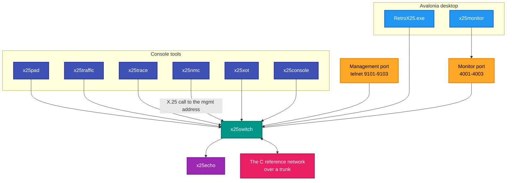
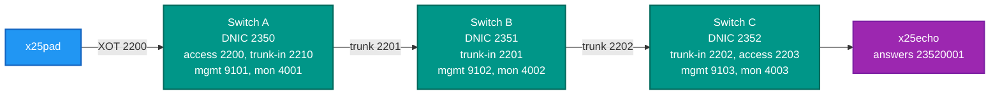
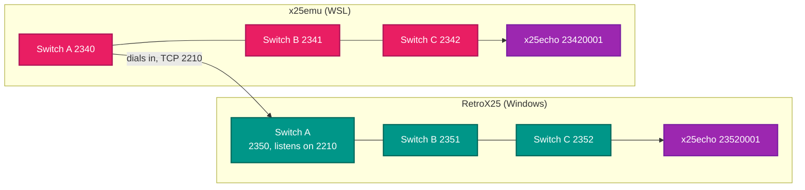

# RetroX25

**An X.25 network you can run.** Ten applications — a packet switch, two desktop front ends, and seven console
tools — built on the `RetroIO.Protocols.X25.*` packages.

[](https://github.com/RetroCoreLabs/RetroX25/actions/workflows/build.yml)
[](https://github.com/RetroCoreLabs/RetroX25/releases)
[](LICENSE)
[](https://github.com/RetroCoreLabs/RetroX25/releases)
[Applications](#the-ten-applications) · [Prerequisites](#prerequisites) · [The demo network](#the-demo-network) · [About X.25](#about-x25)

<!-- A 5-15 second recording: the switch running, a call placed from x25pad, the packets
     appearing in x25monitor. Under 10 MB. Uncomment when the capture exists.

-->
## How this code was written

Some of the code in this repository was written with the help of AI, mostly Claude (Anthropic).
Ronny Hansen directs the work, tests it against real hardware and emulators, and is responsible for
what is in the repository. We say so plainly so you know what you are using.

## Why this repo exists

X.25 is how computers talked to each other before the internet won, and a great deal of surviving equipment still
speaks it: Norsk Data machines, Cisco routers, terminal servers, banking and telex gear. To reach any of it you
need a switch, something to call with, something to answer, and a way to see what actually crossed the wire.

This repository is those things. The protocol work lives in [RetroIO](https://github.com/RetroCoreLabs/RetroIO)
and is consumed here as NuGet packages — so the same packet layer runs in the switch, the desktop app and every
tool, and a fix reaches all of them at once.

It is also one half of a **two-implementation** arrangement. A C emulator (`x25emu`) implements the same
protocols, the two are trunked together, and both read the same X.25 conformance vectors. A disagreement between
them is a failing test rather than an argument.

## The ten applications

| Application | What it is | README |
|---|---|---|
| `x25switch` | The packet switch. Everything else talks to one | [README](src/RetroX25.Switch/README.md) |
| `RetroX25.exe` | Desktop app: PAD client, packet view, routing, configuration | [README](src/RetroX25.Desktop/README.md) |
| `x25monitor` | Desktop network monitor: map, packet analyser, link status | [README](src/RetroX25.Monitor.Desktop/README.md) |
| `x25pad` | Interactive terminal client — places calls | [README](src/RetroX25.Pad/README.md) |
| `x25echo` | Answers calls and echoes data back | [README](src/RetroX25.Echo/README.md) |
| `x25trace` | Wire tracer: connect or listen, decode, hex dump | [README](src/RetroX25.Trace/README.md) |
| `x25traffic` | Load generator: streams and call storms | [README](src/RetroX25.Traffic/README.md) |
| `x25nmc` | Network management console, in-band over X.25 | [README](src/RetroX25.Nmc/README.md) |
| `x25console` | Console emulator driven by `x25config.json` | [README](src/RetroX25.Console/README.md) |
| `x25xot` | XOT client and server, interactive | [README](src/RetroX25.Xot/README.md) |

---

## Status

No tagged release yet, so the release and download badges above are empty until the first
`v*` tag is pushed. The ten applications are built and run.

- **The whole solution builds in Release with no errors**, and three test projects cover it.
- **Two implementations, one set of vectors.** The C emulator `x25emu` implements the same
  protocols, the two are trunked together, and both read the same X.25 conformance vectors.
- **The six-switch demonstration network runs**, and a dialling trunk whose peer does not
  answer now costs 13 ms at start-up instead of a full TCP connect timeout.
- **Not yet measured:** call setup rate and throughput under load. `x25traffic` exists to
  measure them; no number is claimed here because none has been taken.

---
## Prerequisites

| # | Requirement | Needed for | How to check |
|---|---|---|---|
| P1 | .NET SDK as pinned in `global.json` | Everything | `dotnet --info` |
| P2 | PowerShell 7+ | `build.ps1`, `demo.ps1` | `$PSVersionTable.PSVersion` |
| P3 | **RetroIO built and packed to the local feed** (`../localfeed`, beside the repositories) | Restore | `dir ..\localfeed` shows `0.1.0-local.*` |
| P4 | `.\build.ps1` run | Testing the published exes | `dir publish\win-x64\*.exe` lists ten |
| P5 | TCP ports 2200-2203, 2210, 9101-9103, 4001-4003 free | The demo network | `netstat -ano \| findstr "2200 2201 9101 4001"` |
| P6 | A Windows desktop session | `RetroX25.exe`, `x25monitor` | Two of the ten are Avalonia apps |
| P7 | A terminal | The console tools | Any modern terminal |
| P8 | WSL with `x25emu` built | Cross-environment tests only | `wsl -e bash -c 'cd ~/repos/os/x25emu && make -s'` |
| P9 | Inbound TCP 2210 allowed | Cross-environment tests only | The WSL side dials **in** |
| P10 | A real ND machine and the retroterm MCP | Hardware tests only | `terminal_connlist` |

Until the RetroIO packages are on nuget.org they come from the local feed, so **a fresh CI run is red until the
first publish**. That is expected, not a broken build.

```powershell
# from the repository root
.\build.ps1                 # build, test, publish all ten as single self-contained files
.\demo\demo.ps1 start       # three chained switches and an echo service
.\demo\demo.ps1 pad         # a PAD client; at the * prompt:  CALL 23520001
.\demo\demo.ps1 stop        # always stop with the script, never by process name
```

Git Bash or WSL: the same verbs on `./demo/demo.sh`.

---

## How the applications reach the network

Every one of them is a client of a switch. None has a private channel into one — which is why a routing fault
breaks monitoring and management too, and why that is a feature: the monitoring path is itself a proof that
routing works.



**Two different management paths, and confusing them wastes time.** `x25nmc` goes **in-band** — a real X.25 call
to the switch's management address, routed like any other call. `demo.ps1 cli-a` opens a **telnet** session on
port 9101. The interesting test is `x25nmc` reaching switches B and C *through* A.

---

## The demo network

`demo\demo.ps1` starts three chained switches and an echo service.



| Switch | DNIC | Access | Trunk-in | Management (telnet) | Monitor | Management address |
|---|---|---|---|---|---|---|
| A | 2350 | 2200 | 2210 (from WSL) | 9101 | 4001 | 23500000 |
| B | 2351 | — | 2201 | 9102 | 4002 | 23510000 |
| C | 2352 | 2203 | 2202 | 9103 | 4003 | 23520000 |

Echo answers on **23520001**. Management login on every switch: `admin` / `admin`.

**A call from the PAD to `23520001` must cross all three switches**, so `show x25 vc` on *every* switch is the
proof it routed rather than short-circuited.

### Verbs

| Command | What it does |
|---|---|
| `.\demo\demo.ps1 start` | Build and start three switches plus the echo |
| `.\demo\demo.ps1 pad` | A PAD client |
| `.\demo\demo.ps1 gui` | The monitor GUI |
| `.\demo\demo.ps1 cli-a` / `cli-b` / `cli-c` | Telnet to a switch's management console |
| `.\demo\demo.ps1 stop` | Stop everything |
| `.\demo\crossenv-test.ps1` | The automated interop check against the C reference |

`stop` reads and writes `demo\.pids`. **Always stop with the script**; if you must kill something, kill the PID
in that file — never by process name.

---

## Against the C reference implementation

The C emulator (the `x25emu` repository, checked out under WSL) runs on DNICs **2340/2341/2342** — chosen *not* to
collide with this network's 2350/2351/2352, so the two can be trunked.



**The WSL side dials in**, so nothing changes on this side. Start this demo first and allow inbound TCP 2210.

```powershell
.\demo\crossenv-test.ps1
.\demo\crossenv-test.ps1 -WslHost 172.23.178.242 -Port 2001   # if auto-detect fails
```

It finds the WSL address with `hostname -I` (which changes across reboots), calls the reference echo service
`23420001` through the reference switch over XOT, and asserts the echo returns.

Both directions matter: from our PAD, `CALL 23420001` should reach the reference echo; from the reference PAD,
`23520001` should reach ours. **A failure in only one direction is the interesting result** — record which.

### One file, two implementations

The X.25 conformance vectors in `RetroIO/tests/x25-vectors/x25-vectors.json` are read by **this stack and the C
one**. A disagreement about bytes on the wire is therefore a failing test on both sides rather than a mystery on
the trunk.

---

## Tests

| Project | Covers |
|---|---|
| `tests/RetroX25.Desktop.Tests` | The desktop app |
| `tests/RetroX25.Monitor.Desktop.Tests` | The monitor app |

The protocol itself is tested in RetroIO — `tests/RetroIO.Protocols.X25.Tests`, including the shared vectors.
That is the right place for it: these are applications, and a protocol bug found here should become a test there.

Manual test procedures, including the hardware cases, are in
the migration notes, as `Manual tests - RetroX25.md` and `Manual tests - X25 multi-network.md`.

## About X.25

X.25 is how computers talked to each other over public networks before the internet won.
The ITU-T standardised it in 1976 and carriers ran it worldwide - Telenor, Transpac,
Datex-P, Tymnet - into the 2000s. A call is placed to an address, a virtual circuit is set
up across the network, data flows in numbered packets with flow control and error recovery,
and the circuit is cleared. Conceptually it is a telephone call for data.

It matters now because a great deal of surviving equipment still speaks nothing else: Norsk
Data minicomputers, Cisco routers, terminal servers, banking and telex gear. The carriers are
gone, so to reach any of that you have to provide the network yourself - a switch, something
to call with, something to answer, and a way to see what crossed the wire. That is what this
repository is.

The layers, briefly: **LAPB** is the link layer over a serial line; **XOT** (RFC 1613)
carries X.25 over TCP so two sites can be joined across the modern internet; **PAD** (X.3,
X.28, X.29) is the terminal interface a human uses to place a call. The specifications are
ITU-T X.25, X.75 and X.121.

---
## Conventions

- Names follow the workspace naming standard; diagrams follow the workspace Mermaid palette. Both live one level
  up in the workspace root, **outside this repository**, so they are paths rather than links: `NAMING.md` and
  `MERMAID_COLOR_STANDARDS.md`.
- `python eng/check-docs.py` checks every link and diagram in this repo.
- The org is **RetroCoreLabs**. `HackerCorpLabs` is retired and must not appear in anything new.

## Contributing

See [CONTRIBUTING.md](CONTRIBUTING.md) for how to get a build running, what the code is
expected to look like, and what will get a change sent back. A security problem goes through
[SECURITY.md](SECURITY.md) and never a public issue.

## Licence

MIT. See [LICENSE](LICENSE).