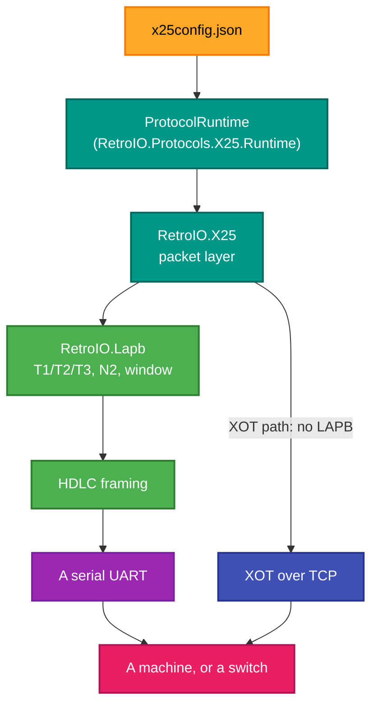
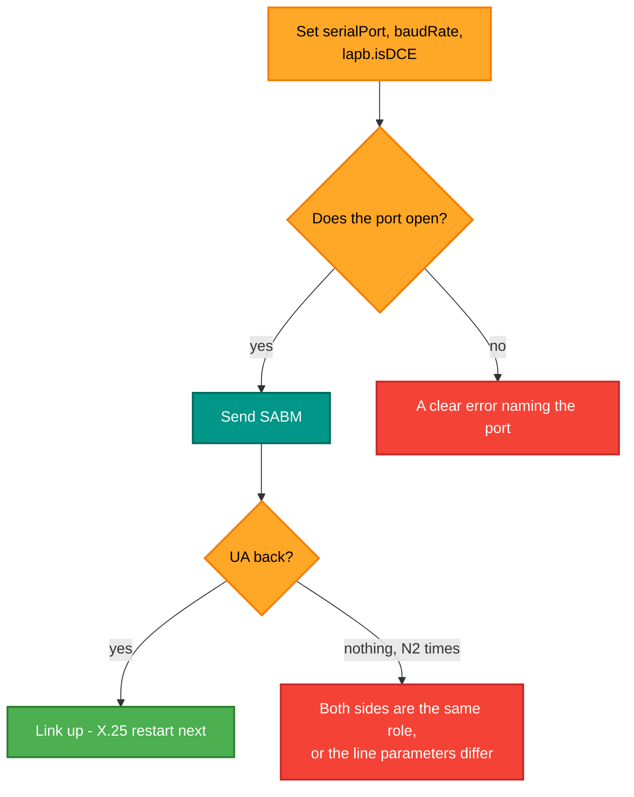

# x25console — the console emulator

## What it is

A full X.25 stack driven entirely from a **JSON configuration file**, with a text-mode interface. It is the whole
runtime — LAPB, the packet layer, routing, timers — running against a serial port or XOT, configured rather than
coded.

## Why you need it

Two things the other tools cannot do.

**A serial line.** `x25pad` and the rest speak XOT, which is X.25 over TCP. A real Norsk Data machine on a cable
wants LAPB over HDLC over a UART, with the right baud rate, the right timers and the right DCE/DTE role. All of
that is configuration here, so matching a piece of hardware is editing a file rather than writing code.

**Tuning the stack.** The configuration exposes the LAPB timers (T1/T2/T3, retries, window, modulo) and the X.25
timers (T20-T23, window, packet size, modulo) directly. When a link will not come up or keeps resetting, those
numbers are usually the reason, and this is where they can be changed one at a time.

It is the closest thing here to a **configurable X.25 node**, which is what makes it the right tool for "will this
talk to that?"

## What you can use it for

- **Connecting over a real serial port** to hardware that expects LAPB.
- Trying either **role**: `lapb.isDCE` both ways, against a matching peer.
- Changing packet and window size and watching traffic still flow.
- Turning on **file logging** to keep a record of a long session.
- Running the whole stack over XOT instead, with the same configuration model.
- Reproducing a customer or hardware configuration exactly, from a file you can keep.

## Prerequisites

| # | Requirement | Why | How to check |
|---|---|---|---|
| P1 | .NET SDK as pinned in `global.json`, or the published exe | To build or run | `dotnet --info` |
| P2 | **A configuration file** | Everything is configured, nothing is implied | `x25config.json` in the working directory, or a path as an argument |
| P3 | A serial port | Only for the serial path | e.g. `COM3`; a wrong name gives a clear error |
| P4 | A peer | Anything live | A switch, a machine, or another `x25console` |
| P5 | A terminal | It is interactive | Any modern terminal |

```powershell
x25console                                              # reads x25config.json from the working directory
x25console docs\config-samples\x25config-example.json   # or a path
x25console docs\config-samples\x25config-xot-test.json  # the XOT path
```

Run with no configuration present and it says so, naming `x25config.json` — not a stack trace.

### Sample configurations

`docs\config-samples\`:

| File | For |
|---|---|
| `x25config-example.json` | The general example |
| `x25config-xot-test.json` | The XOT path |
| `x25-routing-sample.json` | A routing configuration |

## What the configuration holds

| Section | Keys |
|---|---|
| top level | `serialPort`, `baudRate`, `historyCapacity` |
| `lapb` | `T1`, `T2`, `T3` timeouts, `maxRetries`, **`isDCE`**, `windowSize`, `modulo` |
| `x25` | `T20`-`T23`, `maxRetries`, `windowSize`, `packetSize`, `modulo` |
| `routing` | The routing table |
| `timers` | Timer configuration |
| `logging` | `enableFileLogging`, `logFilePath` |

> **`lapb.isDCE` must be the opposite of the peer's.** Two DTEs, or two DCEs, and the link never comes up — and
> the symptom is silence rather than an error, because each side is waiting for the other to start.

## What it assembles



Note the branch: **LAPB is in the path for serial and absent for XOT**, because XOT puts the packet straight onto
TCP, which already provides what LAPB provides.

## Bringing a serial link up



Silence after SABM is almost always the role or the line parameters — not a protocol fault.

Built on `RetroIO.Protocols.X25.Runtime` (`RetroIO/src/RetroIO.Protocols.X25.Runtime/README.md`), which is
where the configuration model lives.
