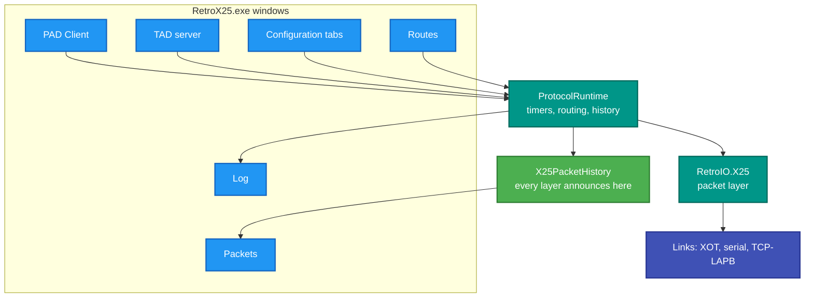
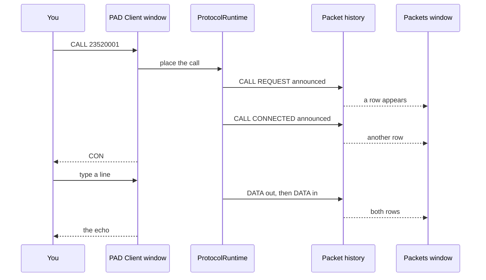

# RetroX25.exe — the desktop application

<!-- A still screenshot of RetroX25.Desktop doing its job. PNG, under 10 MB. Uncomment when
     the capture exists; keep the alt text, it is all a screen reader gets.

-->

## What it is

An Avalonia desktop application that puts the whole X.25 stack behind a window: a PAD client you can type in, a
live packet view, the routing table, full configuration, and and a server window for TAD.

## Why you need it

Because a protocol is much easier to understand when you can **watch** it.

The console tools each do one thing and print lines. This shows the call and the packets that made it at the same
time — place a call in the PAD window, watch the CALL REQUEST, CALL CONNECTED and DATA packets appear in the packet
window as they happen. For learning X.25, or for explaining to somebody else why a call failed, that is worth more
than a log file.

It is also the only place several things are **editable rather than configured**: known hosts, routes, serial
interfaces and XOT interfaces all have edit dialogs, with the configuration surviving a restart. Trying a routing
change is a dialog rather than an INI edit and a restart.

And it can be a **server**, not just a client: the TAD server window answers incoming calls,
which is what you need when the machine on the other end wants to call *you*.

## What you can use it for

- **Placing a call and seeing the packets it produced**, side by side.
- Editing known hosts, routes, serial interfaces and XOT interfaces, with the changes persisted.
- **XOT to a peer with ONE entry**: the XOT mode **Both ways (peer)** dials out when a call is routed to it
  (a new TCP connection for each call, as RFC 1613 asks) and also accepts connections from the same peer, told
  apart by source IP address. The main window shows one row per peer with both directions counted apart. How it
  works, what XOT does not have (no login, no peer identity) and what NAT does to the source address:
  `src/docs/xot-peers.md`.
- **Answering** calls: TAD terminal access (the built-in test service that Cisco routers can call).
- Watching the log at the configured level.
- Simulating a received frame (`SimulateReceive`) to exercise a path with no peer.
- Checking status without a terminal.

## Prerequisites

| # | Requirement | Why | How to check |
|---|---|---|---|
| P1 | .NET SDK as pinned in `global.json`, or the published exe | To build or run | `dotnet --info` |
| P2 | **A Windows desktop session** | It is a GUI — Avalonia | Not usable over a plain SSH session |
| P3 | RetroIO packed to the local feed | Restore | `dir ..\localfeed` |
| P4 | Something to call | The PAD window | `.\src\demo\demo.ps1 start` |
| P5 | A serial port | Only for a serial interface | Configurable, not required |

> **First-launch caveat, stated honestly:** headless tests cannot catch compiled-binding errors or a missing
> `avares://` resource. On the very first window after a change, watch for those specifically — they appear at
> runtime and nowhere else.

## The windows

| Window / tab | What it does |
|---|---|
| **Main** | The "is it up?" screen: host information, one line per interface or link (up or down, LAPB link state, far-end machine), the built-in switch, a "Trunk links" section with the real state of every XOT peer and every HDLC trunk, and one line with the uptime and "All links up" or "n link(s) down". No counters. The menus reach everything else |
| **PAD Client** | An interactive PAD: place a call, type, watch it echo |
| **Packets** | Decoded packets as they happen, live. The counts in the bottom bar are "In this capture": they count the lines this window holds, not the engine's totals |
| **Routes** | The configured routing table |
| **Status** (Ctrl+1) | The only place for counters: one table with a row per counter (HDLC, LAPB, X.25, and per-link bytes, calls and errors) and a column for the engine's total, then one for each link and each transport interface. **Reset Statistics** button (also View > Reset Statistics) |
| **Link Status** (Ctrl+L) | Control and state only: the list of links and interfaces, Start, Stop, LAPB Connect and LAPB Disconnect, and the details (state, LAPB state, V(S) V(R) V(A), far-end machine). No counters |
| **Log** | The log, at the configured level |
| **Configuration → Known Hosts** | Add, edit and delete hosts |
| **Configuration → Routing** | Add and delete routes through a dialog |
| **Configuration → Serial Interfaces** | Add, edit and delete serial interfaces |
| **Configuration → XOT Interfaces** | The same for XOT interfaces |
| **Configuration → LAPB / X.25** | Timers and windows. Modulo is fixed at 8 at both layers; see [modulo-128.md](https://github.com/RetroCoreLabs/RetroX25/blob/main/src/docs/modulo-128.md) |
| **Configuration → Telnet PAD** | Switch the telnet PAD on or off, its port, bind address and maximum sessions; see [A PAD from a normal terminal program](#a-pad-from-a-normal-terminal-program-telnet) |
| **TAD Server** | Answer terminal calls |
| **Simulate Receive** | Inject a frame with no peer present |

### Starting on a configuration file

The app starts on built-in defaults (a serial port that is switched off, and the built-in TAD server). To start
on a file, name it on the command line:

```
RetroX25.exe docs\config-samples\x25config-xot-to-switch.json
```

A file that is missing or not a configuration stops the app with a message naming the file. It does not fall back
to the defaults, because a window that looks right and sends calls nowhere is worse than an error.

**Tools → Configuration → Load...** reads a file into the Configuration window, and **Apply** then restarts the
X.25 engine on those settings. The PAD, TAD and other windows that were open belonged to the old engine and are
closed by the restart; open them again from the Windows menu. The settings are **not saved between runs**: the
next start is on the defaults, or on the file named on the command line.

## How the windows relate to the stack



**The packet window is fed by the history bus, not by the PAD.** Every layer announces what it sent or received
into `X25PacketHistory`, and the window renders that — which is why the packets a *server* window handles appear
there too, and why one packet can be followed through HDLC, LAPB and X.25 under a single id.

## Placing a call, and seeing it



## Related

- `x25monitor` ([README](../RetroX25.Monitor.Desktop/README.md)) watches **other** switches over their monitor
  ports; this application shows its **own** stack. Different jobs.
- The runtime and the history bus are
  `RetroIO.Protocols.X25.Runtime` (`RetroIO/src/RetroIO.Protocols.X25.Runtime/README.md`) and
  `RetroIO.Protocols.X25` (`RetroIO/src/RetroIO.Protocols.X25/README.md`).
- Tests: `src/tests/RetroX25.Desktop.Tests`.

## One program is enough: the built-in switch

The Desktop app can run an X.25 switch inside itself, so it needs no other program to reach a router.
It is a setting in the configuration file, not a separate program:

```
RetroX25.exe docs\config-samples\x25config-embedded-switch.json
```

The file has an `EmbeddedSwitch` section (`Enabled`, and `ConfigFile`, the switch `.ini` file; a relative
path is taken from the folder of the JSON file). The `.ini` is the same format the `x25switch` program reads
(sample: `demo\switch-desktop.ini`). Without the section, the app uses no built-in switch and works with an
external `x25switch` (sample: `docs\config-samples\x25config-xot-to-switch.json`).

With the built-in switch on:
- a PAD call to `23600001` goes from the app through its switch to the Cisco router;
- the router calls `23430200` (the app's TAD) through the same switch;
- do not run the `x25switch` program on the same PC at the same time: both listen on TCP 1998.

Without a switch at all, `docs\config-samples\x25config-tad-callback.json` listens on 1998 and answers the
TAD address directly.

## A PAD from a normal terminal program (telnet)

The app can open a TCP port where any telnet program gets a PAD of its own, so you can use `telnet`, PuTTY or
another terminal emulator instead of the PAD Client window. It is **off by default**; the settings are on
**Configuration → Telnet PAD**: Enable, Port (default 2323), Bind address (default `127.0.0.1`, this computer
only) and Maximum sessions (default 8). Press Apply and the engine restarts with the new settings.

```
telnet 127.0.0.1 2323
PAD> CALL 23430200
```

Each connection has its own PAD and its own call; closing the connection clears the call. The main window shows
`Telnet PAD: listening on 127.0.0.1:2323, 2 sessions`, `Telnet PAD: off`, or `Telnet PAD: failed: ...` (for
example when another program already uses the port). There is no login, so keep the bind address at
`127.0.0.1` unless other computers should be able to use it. In a configuration file the settings are a
`TelnetPad` section (sample: `docs\config-samples\x25config-telnet-pad.json`). More:
[telnet-pad.md](https://github.com/RetroCoreLabs/RetroX25/blob/main/src/docs/telnet-pad.md).

## Is the link working?

The main window says it in plain words:
- **Switch:** line: built in and running (ports, calls), built in and NOT running (with the reason, for
  example a port already in use), or none built in.
- Each XOT line: `Connected (TCP up)`, `Listening, N connection(s) open`, `Far end answers (no call placed
  yet)` or `NOT REACHABLE: <reason>`. A client link only opens its TCP connection at the first call, so the
  app tests the far end every few seconds; a dead switch or router shows before a call fails.
- **Trunk links** section: one block for every trunk, updated about once a second, read from the real state
  of the links (it changes nothing). The blocks for XOT peers are described first, the HDLC trunks after them.
  Each XOT block has three lines:
  1. name, where it comes from (`Desktop link`, or `switch port N` for a port of the built-in switch), which
     way (`we dial` or `we listen`), the address, and the state in colour: `TCP connected`,
     `NOT connected: <reason>`, `listening, N connected`, `listening, nobody connected`, and so on;
  2. what the link does after a failure. A client link of the app: `opens when a call needs it, no automatic
     retry` (it opens its TCP connection only when a call needs it, and after a failure the next call tries
     again). A dialling port of the built-in switch: `redials every 2 s until it connects`;
  3. `last connected` (a time, or `never`), `failed connects` with the last error text, `disconnects`, bytes
     (and, for switch ports, packets) in and out, and the calls placed and answered (for switch ports: calls
     out, in and cleared).

  An **HDLC trunk** of the built-in switch (`hdlc-tcp`, or `hdlc-serial`; see
  [trunk-links.md](https://github.com/RetroCoreLabs/RetroX25/blob/main/src/docs/trunk-links.md)) has the same three
  lines, with the state of the LAPB link, not only of the line: `LAPB link up` (green), `line open, LAPB link not
  up yet`, `line open, LAPB link DOWN`, `NOT connected: <reason>` or `NOT open: <reason>` (red), `listening, nobody
  connected`, `connecting...`. The third line gives when the link last came up, how many times it came up, the
  link resets, the failed dials or opens with the last error, the line drops, frames in and out,
  retransmissions, REJ sent and received, frames the FCS check refused, bytes on the wire, and calls out and in.
  An HDLC port is never taken for the other end of the app's own XOT links, so it never joins the quiet line below.

  The app's own two links to its built-in switch (one that dials the switch, one that the switch dials) are not
  shown as blocks. They are ONE quiet line, `Built-in switch: OK`, which turns red as
  `Built-in switch: PROBLEM - <reason>` only when a part fails (the app's link is not running, the app cannot
  connect to the switch, a switch port is not running, the switch's dialling port cannot reach the app's
  listener, or the switch could not start). An entry counts as part of the built-in switch only by facts: the
  built-in switch is on, and the entry's address is a loopback address and the port of a built-in switch
  port that is its other end. It is not decided by name. An entry that points to an external switch or to a
  router, and a switch port that leads to a real peer (a trunk to a Cisco router), are normal blocks.
- The same link events go to the Log window: opening a connection is Information; a failed connect, a
  connection that ends, and a failed dial of the switch (with the time of the next try) are Warnings.
- Each serial line and each TCP-LAPB link shows its LAPB data link as `Up (data transfer)` or `Down`.
- The bottom line says `Uptime: ...` and either `All links up` or `n link(s) down`. A link counts as up when the
  line runs and, if it runs LAPB, the LAPB link is in data transfer. A switched-off interface is not counted.

## Where the numbers are

Every counter is in the Status window (Ctrl+1) and nowhere else, so a number cannot differ between two windows:

- **Total** column: the engine's own totals (HDLC, LAPB, X.25). The engine keeps no runtime-wide LAPB state, and
  no runtime-wide retransmission or timeout count, so the LAPB state is shown per link only and the Total of the
  two LAPB counts is the sum of the links' own counts.
- One column per TCP-LAPB link (LAPB frames of each class, retransmissions, timeouts, state, wire bytes and
  frames) and one per serial or XOT interface (bytes, open connections, calls, errors). A counter a column does
  not have shows `-`. A serial line's LAPB frame counts are not given out by the engine, so they show `-`.
- **Reset Statistics** (button on the Status window, or View > Reset Statistics) calls the engine's own reset:
  it zeroes the engine's totals and the counters of every link and interface, and the window shows the zeros at
  once. Uptime and state words (such as the LAPB state and the number of open circuits) are kept.
- The Packet window's bottom-bar counts and Clear Packet History (Ctrl+Shift+Delete) are about the packets captured in that
  window only; Clear hides lines and does not touch any counter.

## Burst tests: a large volume from real tools

`src/tests/RetroX25.Desktop.Tests/BurstTests.cs` starts the command-line tools (`x25traffic`, `x25echo`) as real
processes against the Desktop's own runtime, without a screen (headless Avalonia). The tools are found in their own
build folders; the tests use a free loopback port picked at test time, and the PAD test writes a small
embedded-switch file to the temp folder and deletes it afterwards. Every process is stopped by its recorded
process id in a `finally` block. The whole class takes about 15 seconds, each test 1 to 5 seconds.

| Test | Volume | What it checks |
|------|--------|----------------|
| Stream into the TAD | 2000 packets of 128 bytes | The app counted exactly what the tool sent (calls, packets, bytes); Packet window holds the engine's history size and the newest packet; Log window stays within the log provider's limit; the window thread answers a posted job within 2 seconds; at the end no circuit is open and the link is back to "Listening, nobody connected" |
| Call storm | 100 calls, 3 at a time | Every call connected and counted; no circuit left |
| Several tools at once | two streams of 1500 packets and a storm of 40 calls | The totals are the exact sums |
| Q-bit burst | 300 READ PARAMETERS messages | Each one is answered with a PARAMETER INDICATION |
| PAD window | 300 typed lines through the built-in switch to an echo tool | Every line comes back once, in order, and the console follows the last line |

The 2-second limit is a hang detector, not a speed target: with the old one-job-per-packet updates the window
thread was busy for 5 to 27 seconds; now the worst wait seen is under 200 milliseconds. Only the Q bit can be
set from the tools and the client library, so there is no M-bit or D-bit burst.
