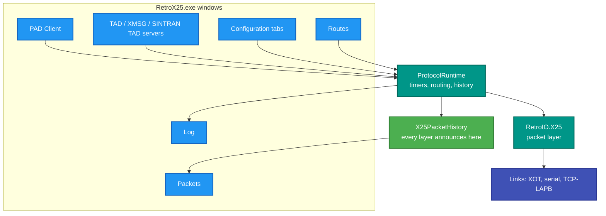
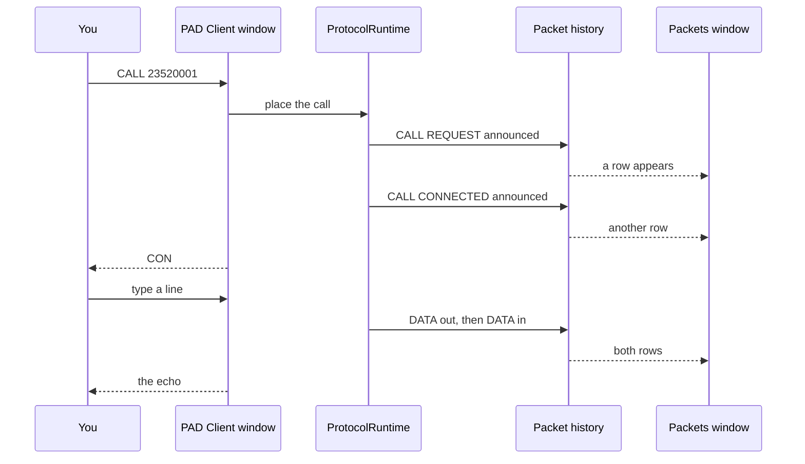

# RetroX25.exe — the desktop application

## What it is

An Avalonia desktop application that puts the whole X.25 stack behind a window: a PAD client you can type in, a
live packet view, the routing table, full configuration, and server windows for TAD, XMSG and SINTRAN TAD.

## Why you need it

Because a protocol is much easier to understand when you can **watch** it.

The console tools each do one thing and print lines. This shows the call and the packets that made it at the same
time — place a call in the PAD window, watch the CALL REQUEST, CALL CONNECTED and DATA packets appear in the packet
window as they happen. For learning X.25, or for explaining to somebody else why a call failed, that is worth more
than a log file.

It is also the only place several things are **editable rather than configured**: known hosts, routes, serial
interfaces and XOT interfaces all have edit dialogs, with the configuration surviving a restart. Trying a routing
change is a dialog rather than an INI edit and a restart.

And it can be a **server**, not just a client: the TAD, XMSG and SINTRAN TAD server windows answer incoming calls,
which is what you need when the machine on the other end wants to call *you*.

## What you can use it for

- **Placing a call and seeing the packets it produced**, side by side.
- Editing known hosts, routes, serial interfaces and XOT interfaces, with the changes persisted.
- **Answering** calls: TAD terminal access, XMSG, and SINTRAN TAD.
- Watching the log at the configured level.
- Simulating a received frame (`SimulateReceive`) to exercise a path with no peer.
- Checking status without a terminal.

## Prerequisites

| # | Requirement | Why | How to check |
|---|---|---|---|
| P1 | .NET SDK as pinned in `global.json`, or the published exe | To build or run | `dotnet --info` |
| P2 | **A Windows desktop session** | It is a GUI — Avalonia | Not usable over a plain SSH session |
| P3 | RetroIO packed to the local feed | Restore | `dir E:\Dev\RCL\localfeed` |
| P4 | Something to call | The PAD window | `.\demo\demo.ps1 start` |
| P5 | A serial port | Only for a serial interface | Configurable, not required |

> **First-launch caveat, stated honestly:** headless tests cannot catch compiled-binding errors or a missing
> `avares://` resource. On the very first window after a change, watch for those specifically — they appear at
> runtime and nowhere else.

## The windows

| Window / tab | What it does |
|---|---|
| **Main** | The entry point; the menus reach everything else |
| **PAD Client** | An interactive PAD: place a call, type, watch it echo |
| **Packets** | Decoded packets as they happen, live |
| **Routes** | The configured routing table |
| **Status** | Runtime status |
| **Log** | The log, at the configured level |
| **Configuration → Known Hosts** | Add, edit and delete hosts |
| **Configuration → Routing** | Add and delete routes through a dialog |
| **Configuration → Serial Interfaces** | Add, edit and delete serial interfaces |
| **Configuration → XOT Interfaces** | The same for XOT interfaces |
| **TAD Server** | Answer terminal calls |
| **XMSG Server** | Answer XMSG calls |
| **SINTRAN TAD Client / Server** | Both ends of SINTRAN terminal access |
| **Simulate Receive** | Inject a frame with no peer present |

Configuration changes **survive a restart** — that is part of what the configuration tabs are for, and worth
checking after any change to them.

## How the windows relate to the stack

**The packet window is fed by the history bus, not by the PAD.** Every layer announces what it sent or received
into `X25PacketHistory`, and the window renders that — which is why the packets a *server* window handles appear
there too, and why one packet can be followed through HDLC, LAPB and X.25 under a single id.

## Placing a call, and seeing it

## Related

- `x25monitor` ([README](../RetroX25.Monitor.Desktop/README.md)) watches **other** switches over their monitor
  ports; this application shows its **own** stack. Different jobs.
- The runtime and the history bus are
  `RetroIO.Protocols.X25.Runtime` (`RetroIO/src/RetroIO.Protocols.X25.Runtime/README.md`) and
  `RetroIO.Protocols.X25` (`RetroIO/src/RetroIO.Protocols.X25/README.md`).
- Tests: `tests/RetroX25.Desktop.Tests`.
