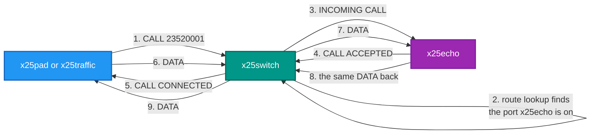
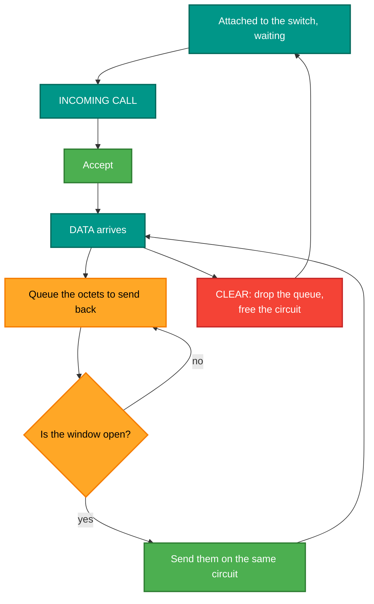

# x25echo — the echo service

## What it is

A tiny X.25 service. It attaches to a switch port, accepts any call routed to its address, and sends every octet
it receives straight back.

## Why you need it

A network needs something at the far end. Until something **answers**, every test ends at "CALL REQUEST sent" and
you cannot tell a routing mistake from a service that is simply not there.

An echo service is the smallest possible answer, and it proves a surprising amount at once: the call was routed, a
channel was allocated at every hop, data flowed in both directions, and flow control lost nothing. It is the X.25
equivalent of `ping`, and for the same reason — you want a known-good target whose own behaviour cannot be the
thing that is broken.

## What you can use it for

- **Proving a path end to end**, which is what the demo uses it for.
- A target for `x25traffic`, so throughput is measured over a round trip rather than a send rate.
- **Checking data integrity** — it echoes byte for byte, so anything different coming back is a real fault.
- Testing your own switch configuration: point a route at its port and call that address.
- Exercising the **called** side — accept, data both ways, and clearing get used on every call.

## Prerequisites

| # | Requirement | Why | How to check |
|---|---|---|---|
| P1 | .NET SDK as pinned in `global.json`, or the published exe | To build or run | `dotnet --info` |
| P2 | **A running switch** | It dials **out** to a switch port and waits | `.\demo\demo.ps1 start` |
| P3 | The switch's XOT host and port | To attach | `-x`; default `127.0.0.1:2006` |
| P4 | **A route pointing at its port** | Otherwise no call ever reaches it | A `[route.N]` entry in the switch INI |
| P5 | An address to answer on | So callers have something to dial | `-a`; default `23420001` |

```
x25echo [-x host:port] [-a address] [-v]
```

| Option | Meaning | Default |
|---|---|---|
| `-x host:port` | The XOT switch port to attach to | `127.0.0.1:2006` |
| `-a address` | The local X.121 address to answer on | `23420001` |
| `-v` | More verbosity; repeat for more | |

```powershell
x25echo -a 23520002 -x 127.0.0.1:2203 -v
```

> **Note the direction.** The echo service **dials the switch** and then waits; it is not a listener. The switch
> routes incoming calls down that existing connection. That is why it needs a route pointing at its port, and why
> starting it before the switch does not work.

> **The default address is `23420001`, which is the C reference network's echo address, not this network's.** In the
> demo, `demo.ps1` starts it on **23520001**. If you run it by hand and then call `23520001`, pass `-a`.

## How a call reaches it



## What it does with a call



The queue exists because the circuit's window can close: the far end may stop acknowledging while data is still
arriving to be echoed. Echoing straight from the receive callback would either block the poll loop or throw the
data away.

Built on `RetroIO.Protocols.X25.Client` (`RetroIO/src/RetroIO.Protocols.X25.Client/README.md`) — the
whole program is a few hundred lines because the protocol work is there.
