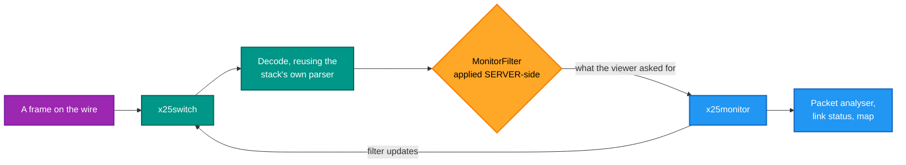
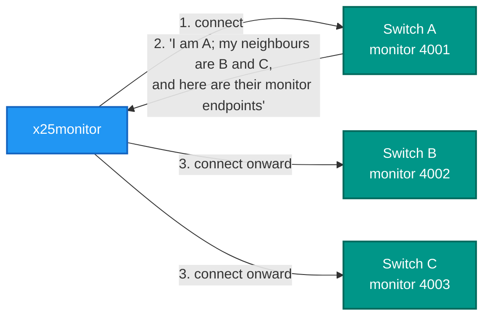

# x25monitor — the network monitor

## What it is

An Avalonia desktop monitor for a **whole X.25 network**. It connects to switches' monitor ports and shows a
network map, a live packet analyser with hex highlighting, per-port link status, and the switches' logs.

## Why you need it

It answers the questions a single switch's console cannot: where is the traffic, which trunk is down, what does the
network actually look like right now.

The design decision that makes it useful is that **the switch decodes and the monitor renders**. A GUI containing
its own protocol decoder would drift from the stack, and a packet view showing something different from what the
switch parsed is worse than no packet view. So the switch sends decoded records, each field carrying a **byte
range** into the raw frame — which is what lets selecting a field highlight the hex it came from.

The second decision: filters are applied **server-side**. A viewer asks for less, and a busy switch sends less,
rather than sending everything for the viewer to discard.

And it can **discover** the network. A switch publishes its identity and its neighbours, including each
neighbour's monitor endpoint, so the monitor connects onward by itself instead of being configured with a list.

## What you can use it for

- Watching **several switches at once**, from one window.
- A live packet analyser during a call, with the hex lined up to the fields.
- **Per-port link status** and counters, moving.
- A **network map** built by discovery — a node with no monitor reads as "no monitor".
- Reading the switches' logs where they were emitted.
- Watching a load test without touching the data path.

## Prerequisites

| # | Requirement | Why | How to check |
|---|---|---|---|
| P1 | .NET SDK as pinned in `global.json`, or the published exe | To build or run | `dotnet --info` |
| P2 | **A Windows desktop session** | It is a GUI — Avalonia | Not usable over a plain SSH session |
| P3 | A switch with a **monitor port** | There is nothing to connect to otherwise | `monitor_port` in the switch INI |
| P4 | The monitor endpoint | To connect | The demo: `127.0.0.1:4001`, `4002`, `4003` |
| P5 | Traffic | To see packets | Run `x25pad` or `x25traffic` alongside |

```powershell
.\demo\demo.ps1 gui      # against the demo network
```

The default endpoint in code is Switch A at **`127.0.0.1:4001`**. Add `4002` and `4003` for B and C.

> **First-launch caveat:** headless tests cannot catch compiled-binding errors or a missing `avares://` resource.
> Watch for those on the first window after a change — they appear at runtime and nowhere else.

## The windows

| Window | Shows |
|---|---|
| **Packet Monitor** | Live decoded packets, with hex highlighting per field |
| **Link Status** | Per-port counters and state |
| **Network Map** | The nodes and the trunks between them, built by discovery |
| **Log** | Log records streamed from the switches |
| **Preferences** | Endpoints and display settings |

## Server decodes, monitor renders



## Building the map by discovery



This is **purely a management overlay** — the X.25 protocol is unaffected. A switch that declares no neighbours
simply cannot be walked onward from, and shows as "no monitor".

## Behaviour worth checking

| Situation | Expected |
|---|---|
| A switch is stopped while connected | Shown as disconnected; **the GUI does not crash** |
| It is started again | Reconnects, or reconnects on one click |
| Left running through a call storm | Keeps up; no freeze, no unbounded memory growth |
| A node with no monitor port | Reads "no monitor" rather than failing |

## Related

- `x25trace` ([README](../RetroX25.Trace/README.md)) is the console equivalent, and works differently: it must be
  **in the data path** as an endpoint. This connects to a monitor port and watches without being in the path.
- The protocol and the decode are
  `RetroIO.Protocols.X25.Monitor` (`RetroIO/src/RetroIO.Protocols.X25.Monitor/README.md`) — **X25MON/1**,
  which the C emulator also speaks, so one monitor can watch both implementations.
- Tests: `tests/RetroX25.Monitor.Desktop.Tests`.
