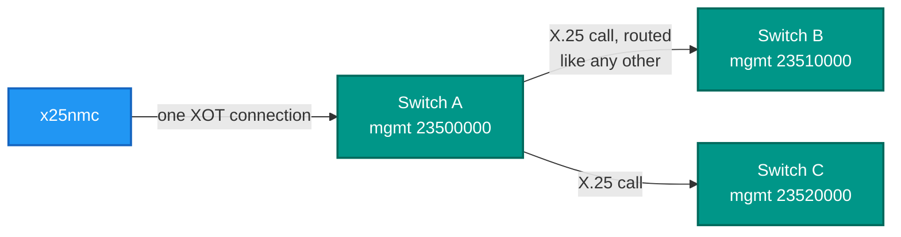
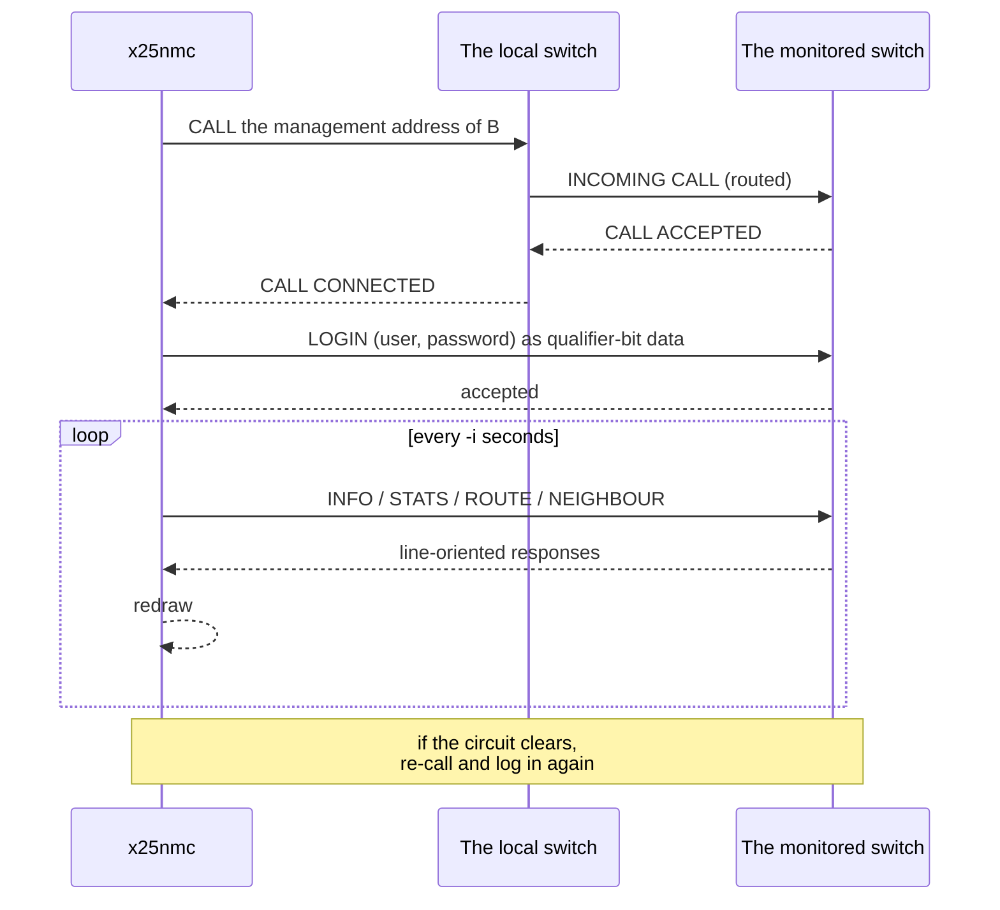
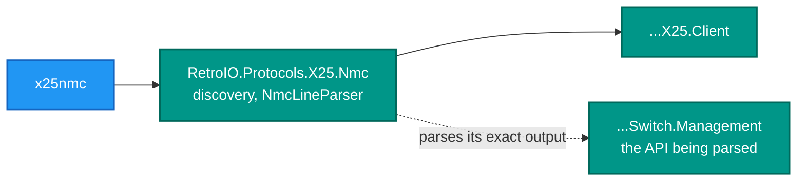

# x25nmc — the network management console

<!-- A still screenshot of RetroX25.Nmc doing its job. PNG, under 10 MB. Uncomment when
     the capture exists; keep the alt text, it is all a screen reader gets.

-->

## What it is

A management console that reaches switches **over X.25 itself**. It connects to a local switch, places an X.25 call
to a switch's management address, authenticates, and polls for status — and it can walk from there to the
neighbours it learns about.

## Why you need it

One switch you can watch with its own telnet console. Ten you cannot, and the questions you actually have are
network-wide: which trunk is down, where are the circuits, which hop is refusing calls.

The deeper reason is that it monitors the network **through the network**. No management LAN, no account on each
box: if a switch is reachable by an X.25 call, it can be monitored. That is how it was done on real networks, and it
has a useful side effect — **the monitoring path is itself a proof that routing works.** A node you cannot reach to
monitor is a node you cannot reach at all.

`x25nmc -a 23510000` reaching switch B **through** switch A is the test worth running, because it exercises
routing, the management API and authentication in one go.

## What you can use it for

- Watching several switches from one place.
- **Reaching a switch you have no other route to**, as long as X.25 can get there.
- Polling at an interval you choose, to watch counters move during a load test.
- Confirming that the management path works — which is a routing test.
- Walking into **another network**: the reference implementation's entry switch can be reached across a trunk.

## Prerequisites

| # | Requirement | Why | How to check |
|---|---|---|---|
| P1 | .NET SDK as pinned in `global.json`, or the published exe | To build or run | `dotnet --info` |
| P2 | A terminal | It draws a status screen | Any modern terminal |
| P3 | **A local switch to connect through** | Every query is an X.25 call placed through it | `.\demo\demo.ps1 start` |
| P4 | The management **address** of each switch | The call destination | `mgmt_addr` in each switch INI |
| P5 | A username and password | The management API authenticates | `[user.N]`; the demo uses `admin` / `admin` |
| P6 | A route to that address | Otherwise the call is refused before it starts | Ordinary routing rules |

```
x25nmc [-x host:port] [-a mgmt-addr] [-u user] [-p pass] [-i interval] [-v]
```

| Option | Meaning |
|---|---|
| `-x host:port` | The local switch's XOT port to connect through |
| `-a mgmt-addr` | The management X.121 address to call |
| `-u user` | Management username |
| `-p pass` | Management password |
| `-i interval` | Poll interval in seconds |
| `-v` | Verbose |

```powershell
x25nmc -x 127.0.0.1:2200 -a 23500000 -u admin -p admin          # switch A
x25nmc -x 127.0.0.1:2200 -a 23510000 -u admin -p admin          # B, THROUGH A
x25nmc -x 127.0.0.1:2200 -a 23520000 -u admin -p admin -i 5     # C, every 5 s
x25nmc -x 127.0.0.1:2200 -a 23400000 -u admin -p admin          # into the C reference network
```

> **This is in-band, not telnet.** `demo.ps1 cli-a` opens a telnet session on port 9101; this places a real X.25
> call to `23500000`. They reach the same management surface by different routes, and only this one works from
> outside the machine without a management LAN.

## Through the network, not around it



One TCP connection, several X.25 calls — one per monitored switch, each on its own logical channel.

## A session



A wrong password is rejected clearly, and a switch that cannot be reached is shown as unreachable and retried —
one dead node does not stop the console.

## What it is built on



The parser is verified **byte-for-byte** against the switch's own output, so the response format is a contract
between the two packages — see
`RetroIO.Protocols.X25.Nmc` (`RetroIO/src/RetroIO.Protocols.X25.Nmc/README.md`).
