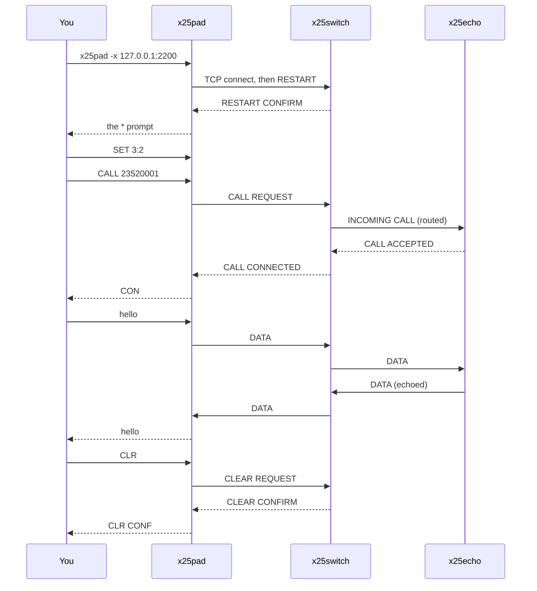
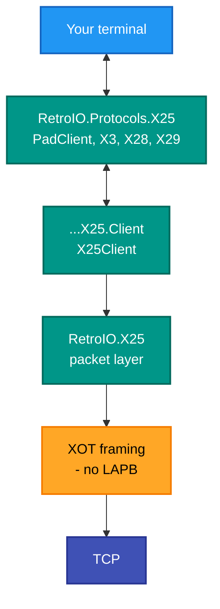

# x25pad — the interactive terminal client

## What it is

A PAD: a Packet Assembler/Disassembler. It turns a terminal into an X.25 DTE — you type, it packs the characters
into X.25 data packets; packets come back, it prints them. It implements ITU-T X.3 (the parameters), X.28 (the
command interface) and X.29 (remote control of those parameters by the far end).

## Why you need it

A switch with nothing calling through it proves nothing. This is the human end of the network: the program that
lets you place a call by hand, see whether it connected, type something, and watch it come back. When a route is
wrong or a call is refused, this is where you find out — because it shows you the **clear cause and diagnostic**
instead of swallowing them.

It is also the historically correct way in. Almost nobody dialled an X.25 host with a bespoke program; they
dialled a PAD, got a `*` prompt, and typed `CALL`.

## What you can use it for

- **Proving a path works** — call the echo service and type; if the characters come back, every hop is doing its
  job.
- Checking a route by hand before wiring anything else up.
- Reading the **reason** a call failed, rather than guessing.
- Reaching a real service, including across a trunk into the C reference network.
- Exercising X.3 behaviour live with `SET` and `PAR`.

## Prerequisites

| # | Requirement | Why | How to check |
|---|---|---|---|
| P1 | .NET SDK as pinned in `global.json`, or the published exe | To build or run | `dotnet --info` |
| P2 | A terminal | It is interactive and puts the tty into character mode | Any modern terminal |
| P3 | **Something to call** | A PAD with no network is a prompt and nothing else | `.\demo\demo.ps1 start` |
| P4 | The switch's host and port | To connect | Default `localhost:1998`; the demo's access port is 2200 |
| P5 | An address to call | X.121 format | Echo answers on `23520001` in the demo |

```
x25pad [-x host:port] [-v]
```

| Option | Meaning |
|---|---|
| `-x host:port` | The XOT peer. Default `localhost:1998` |
| `-v` | More verbosity; repeat for more |

```powershell
.\demo\demo.ps1 pad                      # against the demo network
x25pad -x 127.0.0.1:2200 -v              # by hand
```

## At the `*` prompt (X.28)

| Command | Description |
|---|---|
| `CALL addr` | Place a call |
| `CLR` | Clear the circuit |
| `PAR` | Show the X.3 parameters |
| `SET p:v,...` | Set parameters, e.g. `SET 2:0,3:126` |
| `STAT` | Connection status |
| `RESET` | Reset the circuit |
| `PROF 0/1/2` | Load a profile — 0 transparent, 1 simple, 2 standard |

Once a call connects you are in data transfer mode; the escape character returns you to the `*` prompt.

> **`SET 3:2` matters more than it looks.** Without a forwarding condition the PAD forwards on a timer only, and a
> typed line sits in the PAD for ever. The call connects and nothing happens, which looks like a broken data path
> and is not one.

## A session, end to end



## What it is built on



LAPB is **not** in the path: XOT puts the X.25 packet straight onto TCP, which already provides the reliability
LAPB exists for.

The PAD itself is `RetroIO.Protocols.X25` (`RetroIO/src/RetroIO.Protocols.X25/README.md`); this
application is the terminal handling and the command loop over it.
