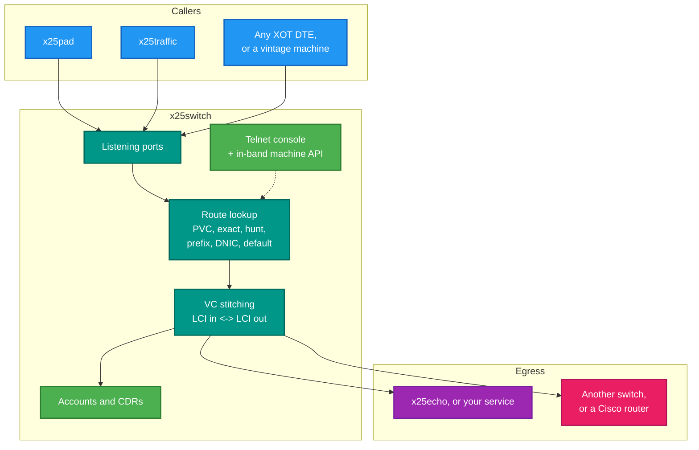
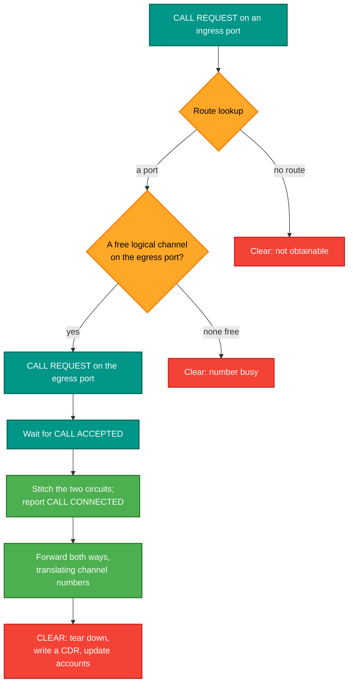
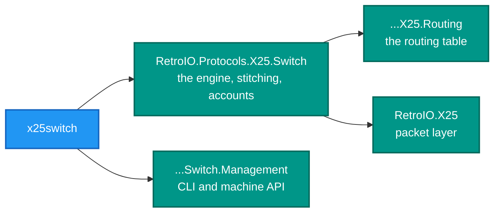

# x25switch — the packet switch

<!-- A still screenshot of RetroX25.Switch doing its job. PNG, under 10 MB. Uncomment when
     the capture exists; keep the alt text, it is all a screen reader gets.

-->

## What it is

`x25switch` is an X.25 switching node. It is the centre of any network built with this repository: every other
application here talks **to** a switch, and a multi-switch network is several of these with trunks between them.

## Why you need it

An X.25 virtual circuit is not a point-to-point link. A DTE places a call to an **address**, and something has to
decide which port that address lives behind, allocate a logical channel on it, and then join the two halves for
the life of the call.

That joining is the switch's whole job, and it is worth being precise: there are **two circuits**, not one. A call
in on one port and a call out on another, each with its own logical channel number, tied together by a stitch.
Per-hop channel numbering is what lets every link use its own small range — and it is why a switch cannot simply
forward packets unchanged.

Without one, you have two programs that can talk to each other directly and no network at all.

## What you can use it for

- **A local test network** — several switches on one machine, trunked, so multi-hop routing can be exercised with
  no hardware.
- **Talking to real equipment**: XOT (RFC 1613) interoperates with Cisco routers and with the C reference
  implementation.
- **Terminating a circuit for your own service** — point a route at a port and answer calls on it, which is all
  `x25echo` does.
- **Per-subscriber accounting**, with Call Detail Records as circuits complete.
- **Being managed**: a telnet console for a person, and an in-band machine API for `x25nmc`.
- Connecting a vintage machine that expects X.25 and nothing else.

## Prerequisites

| # | Requirement | Why | How to check |
|---|---|---|---|
| P1 | .NET SDK as pinned in `global.json`, or the published exe | To build or run | `dotnet --info` |
| P2 | RetroIO packed to the local feed | Restore | `dir ..\localfeed` |
| P3 | **A config file** | Ports, routes, addresses and users are all declarative | `src\demo\switch-a.ini` is the fullest example |
| P4 | Free TCP ports | One per listening port, plus management and monitor | `netstat -ano \| findstr <port>` |
| P5 | No other switch on those ports | A second instance is the classic confusing failure | `.\src\demo\demo.ps1 status` |
| P6 | A peer, a router, or another switch | Only for a trunk | Optional |

```powershell
x25switch src\demo\switch-a.ini -v
```

`<config-file>` is **required** and positional. `-v` raises verbosity and can be repeated; `-v -v` also logs every
X.25 packet each port sends and receives, as hex.

## Configuration

INI. `src\demo\switch-a.ini` is the fullest example.

| Section | Keys |
|---|---|
| `[switch]` | `name`, `dnic`, `mgmt_port`, `monitor_port`, `mgmt_addr` |
| `[port.N]` | `type` (`access`/`trunk`), `transport` (`xot`), `mode` (`dce`/`dte`), `host`, `port`, `lci_base`, `lci_count`; for trunks also `peer_name`, `peer_monitor_host`, `peer_monitor_port`, `peer_mgmt_addr` |
| `[route.N]` | `type` (`prefix`/`default`), `address`, `prefix_len`, `port` |
| `[user.N]` | `name`, `password`, `level` |

Defaults follow the switch configuration specification: window size **2**, packet size **128**, LCI base **1**,
count **16**, TCP port **1998**. A file shorter than you expect is not necessarily incomplete.

A port carries as many calls at once as it has logical channels (`lci_base`, `lci_count`). XOT gives every call its
own TCP connection (RFC 1613 section 5) and the channel number a peer puts on the wire has no meaning, so the switch
numbers each call from the port's own range and the peer's number is not used as it is. `x25traffic` in call-storm
mode holds up to 2048 calls open together, so the demo's access port sets `lci_count = 2048`.

## Where it sits



## What a call does inside it



Route lookup order is fixed and **most specific wins**: PVC, then exact, then hunt group, then longest prefix,
then DNIC, then default. That ordering is why a default route can exist at all.

## The management console

```powershell
.\src\demo\demo.ps1 cli-a        # telnet 127.0.0.1 9101, admin / admin
```

| Command | Shows |
|---|---|
| `show x25 route` | The routes from the INI |
| `show x25 port` | Each port with its type, mode and state |
| `show x25 vc` | The circuits that are up — **empty with no calls** |
| `show x25 stats` | Counters that increase as traffic flows |
| `show x25 account` | Per-subscriber totals |

`show x25 vc` on every switch in a chain is how you prove a call routed end to end.

## What it is built on



The switching engine is `RetroIO.Protocols.X25.Switch` (`RetroIO/src/RetroIO.Protocols.X25.Switch/README.md`);
this application is the host and the configuration loader over it. Anything it does is available to a program as
a library call — which is how the integration tests start switches in-process.
