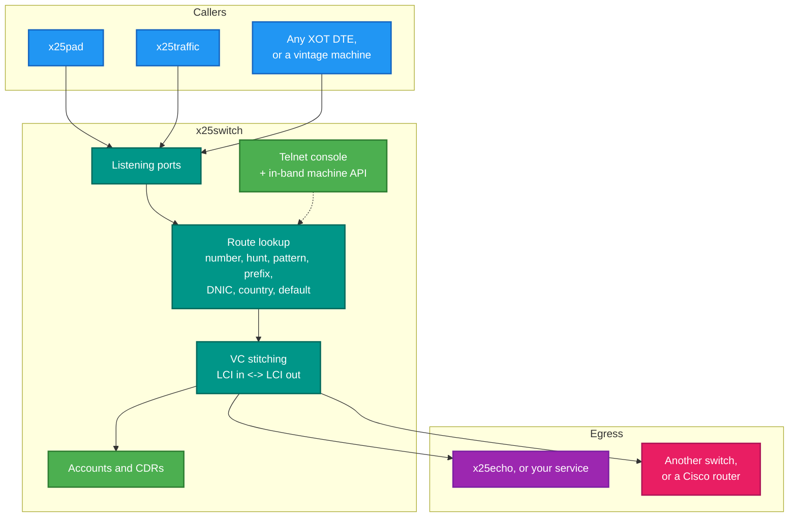
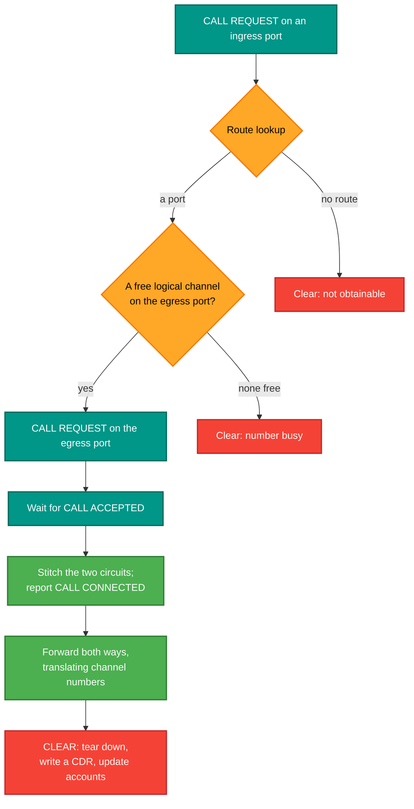
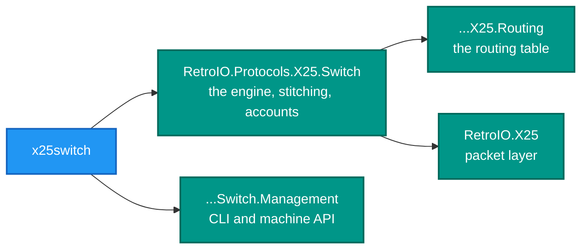

# x25switch — the packet switch

<!-- A still screenshot of RetroX25.Switch doing its job. PNG, under 10 MB. Uncomment when
     the capture exists; keep the alt text, it is all a screen reader gets.

-->

## What it is

`x25switch` is an X.25 switching node. It is the centre of any network built with this repository: every other
application here talks **to** a switch, and a multi-switch network is several of these with trunks between them.

## Why you need it

An X.25 virtual circuit is not a point-to-point link. A DTE places a call to an **address**, and something has to
decide which port that address lives behind, allocate a logical channel on it, and then join the two halves for
the life of the call.

That joining is the switch's whole job, and it is worth being precise: there are **two circuits**, not one. A call
in on one port and a call out on another, each with its own logical channel number, tied together by a stitch.
Per-hop channel numbering is what lets every link use its own small range — and it is why a switch cannot simply
forward packets unchanged.

Without one, you have two programs that can talk to each other directly and no network at all.

## What you can use it for

- **A local test network** — several switches on one machine, trunked, so multi-hop routing can be exercised with
  no hardware.
- **Talking to real equipment**: XOT (RFC 1613) interoperates with Cisco routers and with the C reference
  implementation.
- **Terminating a circuit for your own service** — point a route at a port and answer calls on it, which is all
  `x25echo` does.
- **Per-subscriber accounting**, with Call Detail Records as circuits complete.
- **Being managed**: a telnet console for a person, and an in-band machine API for `x25nmc`.
- Connecting a vintage machine that expects X.25 and nothing else.

## Prerequisites

| # | Requirement | Why | How to check |
|---|---|---|---|
| P1 | .NET SDK as pinned in `global.json`, or the published exe | To build or run | `dotnet --info` |
| P2 | RetroIO packed to the local feed | Restore | `dir ..\localfeed` |
| P3 | **A config file** | Ports, routes, addresses and users are all declarative | `src\demo\switch-a.ini` is the fullest example |
| P4 | Free TCP ports | One per listening port, plus management and monitor | `netstat -ano \| findstr <port>` |
| P5 | No other switch on those ports | A second instance is the classic confusing failure | `.\src\demo\demo.ps1 status` |
| P6 | A peer, a router, or another switch | Only for a trunk | Optional |

```powershell
x25switch src\demo\switch-a.ini -v
```

`<config-file>` is **required** and positional. `-v` raises verbosity and can be repeated; `-v -v` also logs every
X.25 packet each port sends and receives, as hex.

## Configuration

INI. `src\demo\switch-a.ini` is the fullest example. The HDLC trunk keys (`hdlc-tcp`, `hdlc-serial`, the serial and LAPB keys) are explained in [trunk-links.md](../docs/trunk-links.md).

| Section | Keys |
|---|---|
| `[switch]` | `name`, `dnic`, `mgmt_port`, `monitor_port`, `mgmt_addr`. `dnic` is the own network when there is no `[network]` section |
| `[network]` | `own_dnic` (this network's DNIC, 4 digits or 5 with the digit after it; several are separated by commas, and the first one completes local numbers), `international_prefix` (the digits dialled in front of an international number, X.121 7.8; leave it out when the network uses none) |
| `[port.N]` | `name` (used by routes instead of the number; not digits and not `local`), `called_address` (`as_received`, `international` or `national`: the form of the called number sent on this port; a trunk sends the full international number by default, an access port the number as it came in), `type` (`access`/`trunk`), `transport` (`xot` is the default; `hdlc-tcp`, alias `hdlc-ppp`; `hdlc-serial`; any other value is refused), `mode` (`dce`/`dte`), `host`, `port`, `lci_base`, `lci_count`; for trunks also `peer_name`, `peer_monitor_host`, `peer_monitor_port`, `peer_mgmt_addr`. Serial keys: `device`, `baud` (9600), `databits` (8), `parity` (`none`), `stopbits` (1), `flow` (`rtscts`). LAPB keys, in milliseconds except the last two: `lapb_t1` (3000), `lapb_t2` (0), `lapb_t3` (30000), `lapb_n2` (10), `lapb_k` (7); 0 or no key gives the default |
| `[route.N]` | One key that says what the route takes: `number` (one number), `prefix` (numbers starting with these digits), `dnic` (a network, 4 or 5 digits), `dcc` (a country, 3 digits), `default = yes` (everything else, usually the X.75 gateway), `regex` (a pattern over the whole number) or `hunt` (a number shared by the lines of `hunt_group`). Then `port` (name or number), `backup_ports` (tried in this order when `port` is out of order, X.110 3.5), `name`, `note`, `enabled` (`no` keeps the route but skips it), `direction` (`both`, `incoming`, `outgoing`). The old keys still load: `type` (`exact`/`prefix`/`dnic`/`dcc`/`default`/`regex`/`hunt`) with `address`, `prefix_len`, `dnic`, `backup_port`. A type the switch does not know stops the load and names the section and line |
| `[hunt.N]` | `members` (port numbers, separated by commas). A member whose port is down is skipped |
| `[user.N]` | `name`, `password`, `level` |

The lookup tries the most exact route first, whatever order the sections are in: a number or hunt group, a
pattern, the longest prefix, a network with its fifth digit, a network, a country, the default route. A route
that would send a call back out of the port it came in on is never used. The tariff file's `home_dnic` is a
separate setting: it decides how a call is priced, not where it goes.

One example, for a switch in network 2422 with an access port, a gateway to other networks and a second way out
(the transport keys of the ports are left out; see the table above):

```ini
[network]
own_dnic = 2422
international_prefix = 0

[port.0]
name = terminals
type = access

[port.1]
name = x75-gw
type = trunk

[port.2]
name = nordic
type = trunk

; A local number: 110006 typed on a terminal is completed to 2422110006.
[route.0]
name = TAD
number = 2422110006
port = terminals

; Every call to Sweden's Datapak network, with a second way out.
[route.1]
name = Datapak
dnic = 2402
port = x75-gw
backup_ports = nordic

; Every other call in Denmark (country code 238).
[route.2]
name = Denmark
dcc = 238
port = nordic

; Everything else goes to the gateway, or the other trunk when it is down.
[route.3]
name = Gateway
default = yes
port = x75-gw
backup_ports = nordic
```

Defaults follow the switch configuration specification: window size **2**, packet size **128**, LCI base **1**,
count **every channel from the base up to 4095** (16 before 2026-11-18), TCP port **1998**. `max_calls` in
`[switch]` limits the calls the whole switch carries at once; 0 or absent = no limit, and the call over the limit
is cleared with Network congestion (cause 5). A file shorter than you expect is not necessarily incomplete.

A port carries as many calls at once as it has logical channels (`lci_base`, `lci_count`). XOT gives every call its
own TCP connection (RFC 1613 section 5) and the channel number a peer puts on the wire has no meaning, so the switch
numbers each call from the port's own range and the peer's number is not used as it is. `x25traffic` in call-storm
mode holds up to 2048 calls open together, so the demo's access port sets `lci_count = 2048`.

## Where it sits



## What a call does inside it



Route lookup order is fixed and **most specific wins**: a number or hunt group, then a pattern, then the longest
prefix, then a network with its fifth digit, then a network, then a country, then the default route (PVCs are set
up at start and never looked up). That ordering is why a default route can exist at all. When the chosen port is
down its backups are tried in order, and only when all are down is the call cleared out of order.

## The management console

```powershell
.\src\demo\demo.ps1 cli-a        # telnet 127.0.0.1 9101, admin / admin
```

| Command | Shows |
|---|---|
| `show x25 route` | The routes from the INI |
| `show x25 port` | Each port with its type, mode and state |
| `show x25 vc` | The circuits that are up — **empty with no calls** |
| `show x25 stats` | Counters that increase as traffic flows |
| `show x25 account` | Per-subscriber totals |

`show x25 vc` on every switch in a chain is how you prove a call routed end to end.

## What it is built on



The switching engine is `RetroIO.Protocols.X25.Switch` (`RetroIO/src/RetroIO.Protocols.X25.Switch/README.md`);
this application is the host and the configuration loader over it. Anything it does is available to a program as
a library call — which is how the integration tests start switches in-process.
