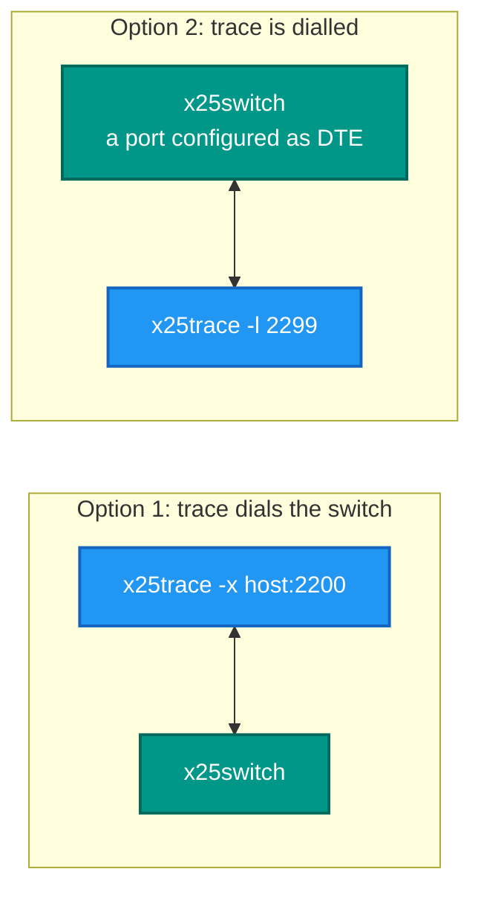
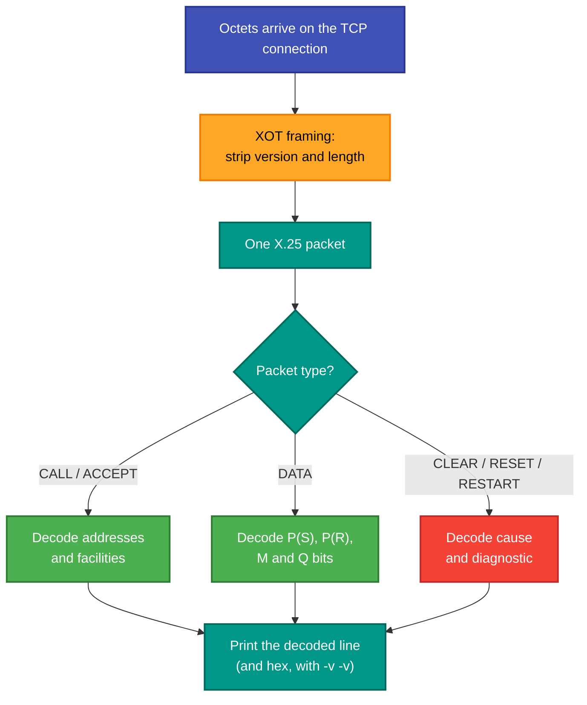

# x25trace — the wire tracer

<!-- A still screenshot of RetroX25.Trace doing its job. PNG, under 10 MB. Uncomment when
     the capture exists; keep the alt text, it is all a screen reader gets.

-->

## What it is

A passive packet decoder. It sits on an XOT connection, reads whatever crosses it, and prints each X.25 packet
decoded into readable fields — packet type, logical channel, addresses, facilities, sequence numbers, causes and
diagnostics. With more verbosity it prints the hex as well.

## Why you need it

When a call fails, the interesting information is in a packet nobody looked at. A clear carries a **cause** and a
**diagnostic**; a refused call says why; a circuit that resets says what reset it. Those bytes are the difference
between "it does not work" and "the called address is not obtainable, diagnostic 67".

It is also the only honest way to settle an interoperability argument. If a Cisco router, a SINTRAN machine or the
C reference implementation disagrees with this one, the question is which octets went past — not which program's
log is more convincing.

## What you can use it for

- **Diagnosing a refused or cleared call** — read the cause and diagnostic rather than guessing.
- Checking XOT interop: confirm the header and the packet are what RFC 1613 asks for.
- Watching a handshake in order: restart, call set-up, accept, data, clear.
- **Verifying facility negotiation** — packet and window size, reverse charging and the rest are in the call
  packets and this prints them.
- Confirming whether a stall is a **window** problem or a lost packet, from the sequence numbers and RR/RNR.
- Capturing evidence for a bug report that is not an opinion.

## Prerequisites

| # | Requirement | Why | How to check |
|---|---|---|---|
| P1 | .NET SDK as pinned in `global.json`, or the published exe | To build or run | `dotnet --info` |
| P2 | **Traffic to look at** | It decodes; it does not generate | Run `x25pad` or `x25traffic` alongside |
| P3 | Either a port to dial or one to listen on | It must be in the path | `-x` to dial, `-l` to be dialled |
| P4 | A spare switch port, or a peer willing to dial it | It is an **endpoint**, not a tap | Add a port to the switch INI |

```
x25trace [-x host:port] [-l port] [-v]
```

| Option | Meaning |
|---|---|
| `-x host:port` | Dial an XOT peer and decode what arrives |
| `-l port` | Listen for an incoming XOT connection instead |
| `-v` | More verbosity; **repeat for hex dumps** |

```powershell
x25trace -l 2299                        # point a trunk at it
x25trace -x 127.0.0.1:2200 -v -v        # dial, with hex
```

> **An important limit, said plainly: this is an endpoint, not a packet sniffer.** It decodes traffic on a
> connection it is party to. To see traffic between two *other* programs, put it between them — give the switch a
> port that dials it, or have one side dial it. For genuine passive capture of somebody else's socket, use
> Wireshark on the TCP port and decode the XOT payload.

## Where to put it



## What it does with each packet



## Related

- `x25monitor` ([README](../RetroX25.Monitor.Desktop/README.md)) is the graphical equivalent, and it works
  differently in a way that matters: it connects to a switch's **monitor port** and receives frames the switch
  decoded, so it can watch a switch without being in the data path. `x25trace` must be in the path.
- The decode itself reuses the same parser as the stack, in
  `RetroIO.X25` (`RetroIO/src/RetroIO.X25/README.md`), so what it prints cannot drift from what the stack
  parsed.
