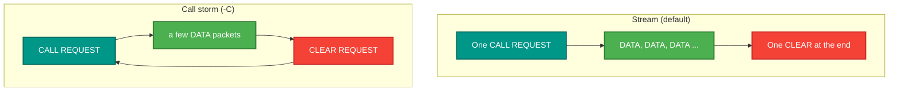
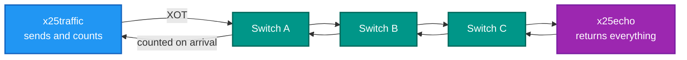

# x25traffic — the load generator

<!-- A still screenshot of RetroX25.Traffic doing its job. PNG, under 10 MB. Uncomment when
     the capture exists; keep the alt text, it is all a screen reader gets.

-->

## What it is

Drives load through an X.25 network and reports what arrived. Two modes: **stream**, which places one call and
sends a continuous series of data packets, and **call storm** (`-C`), which opens and tears down circuits as fast
as you ask.

## Why you need it

One call by hand proves a path exists. It says nothing about a thousand packets a second, two thousand open
circuits, or whether anything leaks when a circuit closes — which are exactly the failures that stay hidden until
somebody else depends on the network.

The two modes exist because they break different things:

- **A long stream** pushes on **flow control** — windows, acknowledgements, the receive path, buffer reuse.
- **A call storm** pushes on **state management** — channel allocation, the routing table, per-call bookkeeping,
  and anything allocated on set-up that must be released on clear.

And it reports **delivery**, not send rate. A generator that counts only what it wrote cannot tell you the network
dropped half of it.

## What you can use it for

- Throughput: how many packets a second a path really carries.
- Call set-up rate: how fast the switch allocates, routes and releases circuits.
- **Finding leaks** — thousands of call/clear cycles make a small per-call leak obvious. `show x25 vc` must be
  empty afterwards.
- Proving a change did not cost performance, by running the same command before and after.
- Loading a **multi-hop** network rather than one switch, to find where the limit actually is.

## Prerequisites

| # | Requirement | Why | How to check |
|---|---|---|---|
| P1 | .NET SDK as pinned in `global.json`, or the published exe | To build or run | `dotnet --info` |
| P2 | A running switch | It is a DTE and needs a network | `.\src\demo\demo.ps1 start` |
| P3 | **Something that answers** | Otherwise you measure refusals | `x25echo`, and aim at its address |
| P4 | The XOT host and port | To attach | `-x`; the demo's access port is 2200 |
| P5 | **An address to call** | Required — there is no default destination | `-d 23520001` |
| P6 | Enough logical channels | A storm with more VCs than the port has measures "number busy" | the port's `lci_count` in the INI; a storm holds one channel and one connection per open call |

```
x25traffic -x host:port -d address [options]

  Stream mode (default):  -n count (0=infinite)   -r rate pkts/sec (0=max)
  Call storm mode (-C):   -C   -n calls   -r calls/sec   -p pkts per call (default 3)
  Common:                 -s size (default 128)   -v
```

| Option | Meaning |
|---|---|
| `-x host:port` | XOT endpoint |
| `-d address` | The called X.121 address. **Required** |
| `-C` | Call-storm mode |
| `-n count` | Packets (stream) or calls (storm). `0` = infinite |
| `-r rate` | Per second. `0` = as fast as possible |
| `-p pkts` | Packets per call in storm mode. Default 3 |
| `-s size` | Packet size. Default 128 |
| `-v` | Verbose |

```powershell
x25traffic -x 127.0.0.1:2200 -d 23520001 -n 1000 -r 100     # 1000 packets at 100/s
x25traffic -x 127.0.0.1:2200 -d 23520001 -s 16              # small packets
x25traffic -x 127.0.0.1:2200 -d 23520001 -C -n 200 -r 20 -p 5   # a call storm
x25traffic -x 127.0.0.1:2200 -d 23520001 -n 0               # until Ctrl-C
```

## The two modes



Stream stresses flow control and the data path. Call storm stresses allocation and release — it is the one that
finds leaks.

## Where it sits



## Reading the result

Packets carry a sequence number and the tool tracks which came back, so the figure is **delivery**. That
distinction is not academic: an earlier soak test counted flow control as errors and cleared circuits with data
still in flight, and **both numbers lied** while the suite stayed green.

After a call storm, check `show x25 vc` on the switch — it must be **empty**. Circuits left behind are the leak
the storm exists to find.

> **A known issue to rule out first:** the bulk-transfer stall recorded in
> the X.25 integration-test notes in the migration notes, where `PeerAcked` never leaves 0. If a stream run stalls, that
> is probably this — a known open item, not a new fault.

Built on `RetroIO.Protocols.X25.Client` (`RetroIO/src/RetroIO.Protocols.X25.Client/README.md`).
