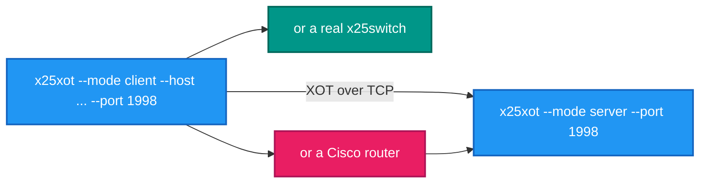

# x25xot — the XOT test application

<!-- A still screenshot of RetroX25.Xot doing its job. PNG, under 10 MB. Uncomment when
     the capture exists; keep the alt text, it is all a screen reader gets.

-->

## What it is

A standalone Terminal.Gui application for testing **XOT** — X.25 over TCP — in either direction. It runs as a
client, as a server, or interactively with a menu and function keys.

## Why you need it

Because sometimes you need to send **one packet** and see exactly what comes back, and every other tool here is
busy being a correct X.25 implementation.

`x25pad` places a call and manages a circuit properly. This is the level below: open an XOT connection, push a
call request, watch the bytes. When a peer is rejecting something and the specification does not explain why, being
able to send a single packet by hand — and to be the **server** so you can see what the other side sends first — is
what settles it.

## What you can use it for

- **Being either end** of an XOT connection: `--mode client` or `--mode server`.
- Sending packets by hand in the XOT Test window: Call Request, Call Accept, Data, Clear, RR, RNR, Reset, or a
  packet you type as hex.
- Proving two endpoints connect at all, before anything more complicated is attempted.

## Prerequisites

| # | Requirement | Why | How to check |
|---|---|---|---|
| P1 | .NET SDK as pinned in `global.json`, or the published exe | To build or run | `dotnet --info` |
| P2 | A terminal | Terminal.Gui draws on it; function keys must reach it | A real terminal, not a pipe |
| P3 | A peer, or this tool in the other mode | Anything useful | Two shells: one server, one client |
| P4 | A free TCP port | Server mode | 1998 is the conventional XOT port |

```powershell
x25xot --mode server --port 1998                          # be the server
x25xot --mode client --host 127.0.0.1 --port 1998         # be the client
x25xot                                                    # interactive menu
x25xot --help                                             # usage
```

## Client and server, both from here



Running it against **itself**, in two shells, is the first thing to try: if that does not connect, the problem is
local and not the peer.

## The windows, and which to pick

The interactive menu offers: 1) raw XOT client, 2) raw XOT server, 3) help, 4) quit. Both open the XOT Test
window. `--mode` on the command line takes only `client` and `server`.

**No LAPB under XOT.** RFC 1613 XOT puts the X.25 packet straight onto TCP. Pointing a LAPB-based client at an XOT
peer produces a link that looks dead for no visible reason.

**For a terminal session over X.25** use a real PAD: the PAD window of the RetroX25 desktop app, `RetroX25.Pad`
(console or telnet), or x25emu's `x25pad`. This tool has no PAD of its own.

## Function keys

XOT Test window:

| Key | Sends |
|---|---|
| F1 | Call Request |
| F2 | Call Accept |
| F3 | Data |
| F4 | Clear Request |
| F5 | A packet typed as hex |
| F6 | RR (Receive Ready) |
| F7 | RNR (Receive Not Ready) |
| F8 | Reset Request |
| F9 | Quit |

## Command-line parameters

| Parameter | Description | Example |
|-----------|-------------|---------|
| `--mode`, `-m` | `client` or `server` | `--mode server` |
| `--host`, `-h` | Remote host (client mode only; required there) | `--host 192.168.1.100` |
| `--port`, `-p` | TCP port (required in both modes) | `--port 1998` |
| `--help`, `-?` | Show the usage text | |

## File structure

```
RetroX25.Xot/
├── Program.cs                      # Entry point, command-line parsing, menu
├── XotTestWindow.cs                # XOT test window (low-level)
├── HexInputDialog.cs               # Custom hex packet input dialog
├── XotTestServer.cs                # Lightweight XOT server
├── XotTestClient.cs                # Lightweight XOT client
├── XotConnection.cs                # One XOT connection
├── XotPacketFormatter.cs           # Packet display text
└── PredefinedPackets.cs            # The packets the function keys send
```

## References

- **RFC 1613**: X.25 over TCP (XOT)
- **ITU-T X.25**: Packet Layer Protocol
- **ITU-T X.3**: PAD Parameters
- **ITU-T X.28**: DTE/DCE Interface for PAD
- **ITU-T X.29**: Procedures for PAD

## Build and run

```powershell
# The usual way: build.ps1 builds, tests and publishes every app in this repo, from the repository root
.\src\build.ps1

# Or just this project
dotnet build src\RetroX25.Xot\RetroX25.Xot.csproj -nodeReuse:false

# The published single-file executable, after build.ps1:
#   src\publish\win-x64\x25xot.exe
```

The application is built on Terminal.Gui and Microsoft.Extensions.Logging.

## Licence

MIT. See the LICENSE file in the repository root.
