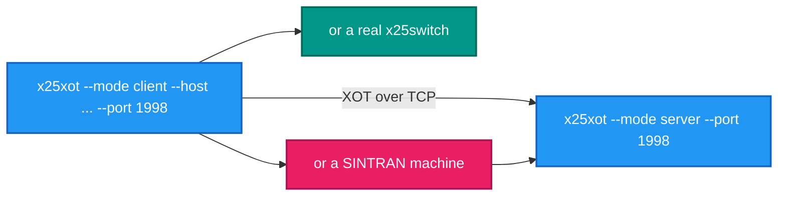
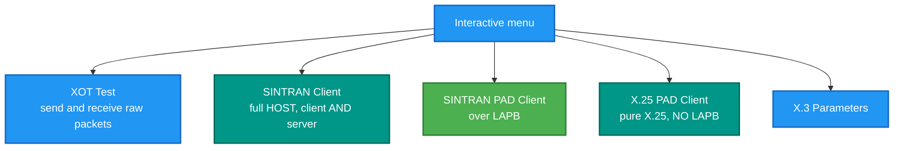
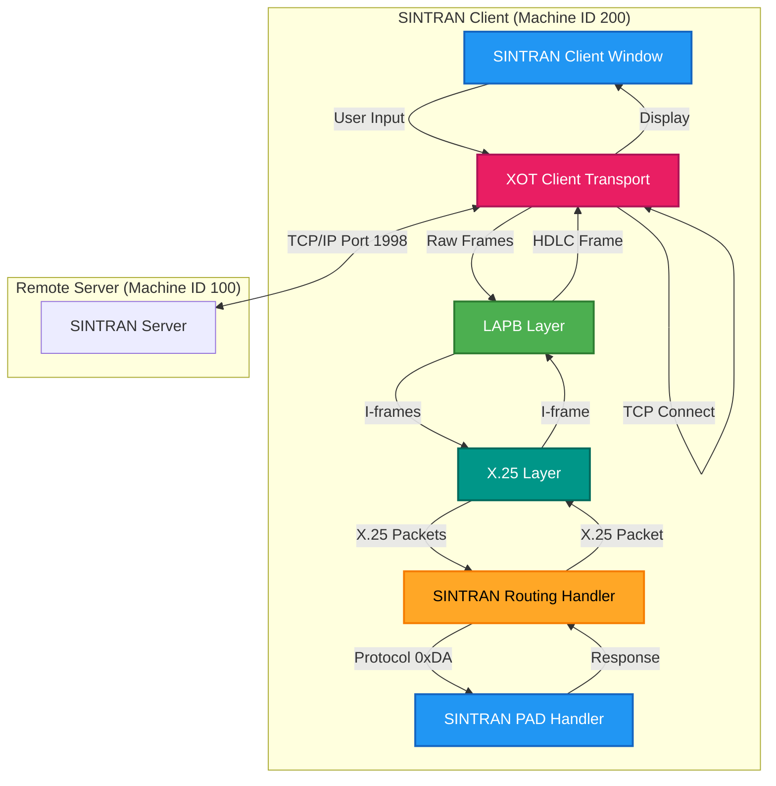
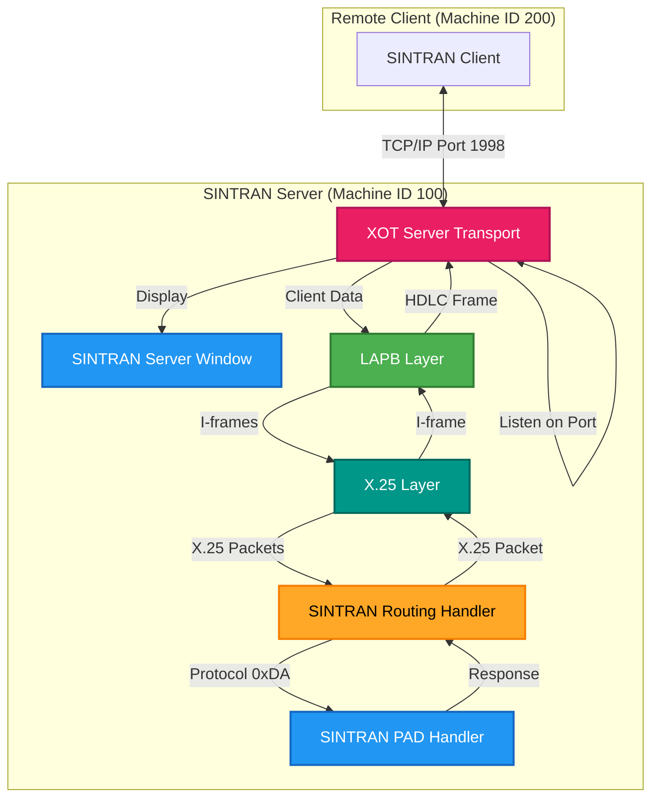
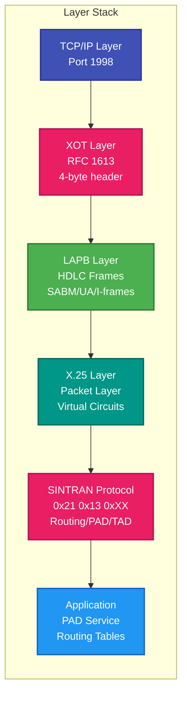
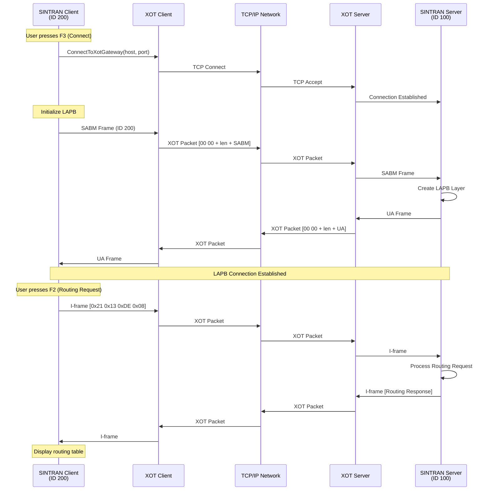
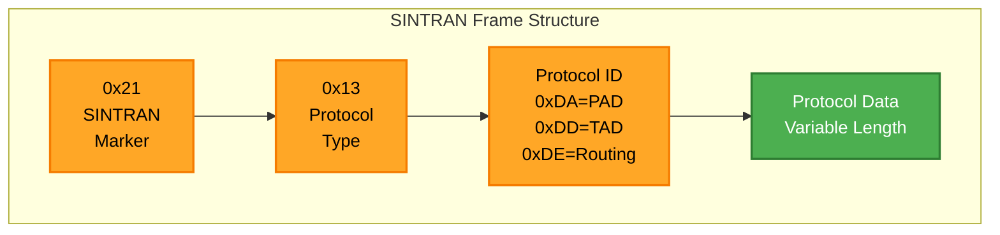
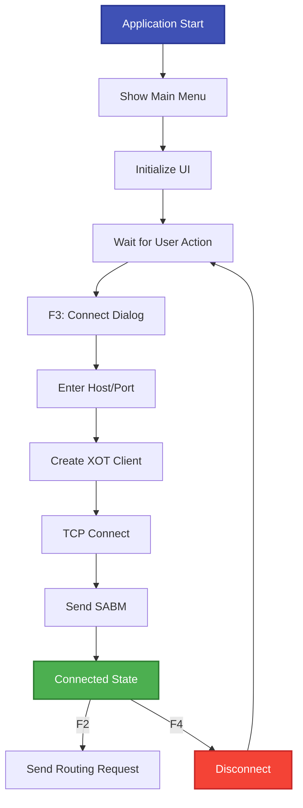
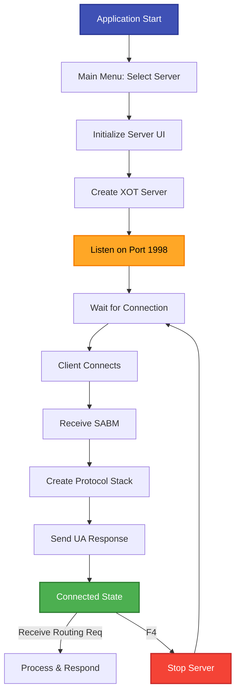

# x25xot — the XOT test application

## What it is

A standalone Terminal.Gui application for testing **XOT** — X.25 over TCP — in either direction, with SINTRAN
routing support. It runs as a client, as a server, or interactively with a menu and function keys.

## Why you need it

Because sometimes you need to send **one packet** and see exactly what comes back, and every other tool here is
busy being a correct X.25 implementation.

`x25pad` places a call and manages a circuit properly. This is the level below: open an XOT connection, push a
call request, watch the bytes. When a peer is rejecting something and the specification does not explain why, being
able to send a single packet by hand — and to be the **server** so you can see what the other side sends first — is
what settles it.

It is also the tool for the **SINTRAN** side of XOT: a full SINTRAN HOST implementation in both roles, a SINTRAN
PAD client over LAPB, and a pure X.25 PAD client with no LAPB. Having all three in one place is how the difference
between them gets established, because the difference is exactly what breaks interoperability.

## What you can use it for

- **Being either end** of an XOT connection: `--mode client` or `--mode server`.
- Sending a call request by hand (**F1** in interactive mode) and reading the answer.
- Testing the **SINTRAN HOST** protocol in client and server roles.
- Comparing a SINTRAN PAD client **over LAPB** with a pure X.25 PAD client **without** it — the two are genuinely
  different on the wire.
- Configuring X.3 parameters interactively and seeing the effect.
- Proving two endpoints connect at all, before anything more complicated is attempted.

## Prerequisites

| # | Requirement | Why | How to check |
|---|---|---|---|
| P1 | .NET SDK as pinned in `global.json`, or the published exe | To build or run | `dotnet --info` |
| P2 | A terminal | Terminal.Gui draws on it; function keys must reach it | A real terminal, not a pipe |
| P3 | A peer, or this tool in the other mode | Anything useful | Two shells: one server, one client |
| P4 | A free TCP port | Server mode | 1998 is the conventional XOT port |
| P5 | A SINTRAN machine | The SINTRAN windows, for a real test | Record as SKIPPED if unavailable |

```powershell
x25xot --mode server --port 1998                          # be the server
x25xot --mode client --host 127.0.0.1 --port 1998         # be the client
x25xot                                                    # interactive menu
x25xot --help                                             # usage
```

In interactive mode, **F1 sends a Call Request**.

## Client and server, both from here



Running it against **itself**, in two shells, is the first thing to try: if that does not connect, the problem is
local and not the peer.

## The windows, and which to pick



**The LAPB distinction is the one to get right.** The SINTRAN PAD client runs over LAPB; the X.25 PAD client does
not, because RFC 1613 XOT puts the packet straight onto TCP. Pointing the wrong one at a peer produces a link that
looks dead for no visible reason.

---

The sections below are the detailed reference: every command-line parameter, every window, and the client/server state machines.

## Table of Contents
- [Overview](#overview)
- [Command-Line Arguments](#command-line-arguments)
- [Usage Instructions](#usage-instructions)
- [Architecture Overview](#architecture-overview)
- [Client vs Server Modes](#client-vs-server-modes)
- [Window Types](#window-types)

---

## Overview

This application provides multiple testing windows for XOT protocol development:

- **XOT Test Window** - Basic XOT packet send/receive testing
- **SINTRAN Client Window** - Full SINTRAN HOST implementation (client and server modes)
- **SINTRAN PAD Client Window** - SINTRAN PAD client over LAPB
- **X.25 PAD Client Window** - Pure X.25 PAD client (no LAPB)
- **X.3 Parameters Window** - X.3 PAD parameter configuration

---

## Command-Line Arguments

### SINTRAN Client/Server Mode

```bash
# Server Mode (listen for incoming connections)
x25xot --mode server --port <port> --machine-id <id>

# Client Mode (connect to remote host)
x25xot --mode client --host <hostname> --port <port> --machine-id <local-id> --remote-id <remote-id>

# Interactive Mode (show menu)
x25xot
```

### Command-Line Parameters

| Parameter | Description | Default | Example |
|-----------|-------------|---------|---------|
| `--mode` | Operation mode: `client`, `server`, `sintran`, `sintran-pad`, `x25-pad` | (menu) | `--mode server` |
| `--host` | Remote host for client mode | `localhost` | `--host 192.168.1.100` |
| `--port` | TCP port (client or server) | `1998` | `--port 1998` |
| `--machine-id` | Local SINTRAN machine ID | `200` | `--machine-id 100` |
| `--remote-id` | Remote SINTRAN machine ID (client mode) | `0` | `--remote-id 200` |

### Examples

```bash
# Start SINTRAN server on port 1998 with machine ID 100
x25xot --mode server --port 1998 --machine-id 100

# Connect to SINTRAN server at localhost:1998 as machine ID 200
x25xot --mode client --host localhost --port 1998 --machine-id 200 --remote-id 100

# Start SINTRAN PAD client as machine ID 200
x25xot --mode sintran-pad --machine-id 200

# Start pure X.25 PAD client (no SINTRAN)
x25xot --mode x25-pad

# Show interactive menu
x25xot
```

---

## Usage Instructions

### Running as SINTRAN Server

1. **Start the server**:
   ```bash
   x25xot --mode server --port 1998 --machine-id 100
   ```

2. **Wait for connections**:
   - Server listens on `0.0.0.0:1998` (all interfaces)
   - Window title shows: `SINTRAN HOST - ID:100 - TCP Server :1998 - LISTENING`

3. **Client connects**:
   - Server receives SABM frame from client
   - Protocol stack initializes (LAPB + X.25 + SINTRAN routing)
   - Window title updates: `TCP Server :1998 - CLIENT CONNECTED`

4. **Monitor activity**:
   - **SENT PACKETS** section shows outgoing frames
   - **RECEIVED PACKETS** section shows incoming frames
   - **ROUTING INFO** section shows LAPB state and routing requests
   - **PAD SERVER STATUS** section shows PAD service status

5. **Disconnect**:
   - Press **F4** to stop server and disconnect client
   - Press **F9** to quit application

### Running as SINTRAN Client

1. **Start the client**:
   ```bash
   x25xot --mode client --host localhost --port 1998 --machine-id 200 --remote-id 100
   ```

2. **Connection process**:
   - Client connects to XOT gateway at `localhost:1998`
   - Sends SABM frame with local machine ID (200)
   - Waits for UA response from server

3. **After connection**:
   - Window title shows: `TCP Client localhost:1998 - CONNECTED`
   - Press **F2** to send routing info request
   - Press **F4** to disconnect

4. **Interactive connection** (via F3 key):
   - Press **F3** to show connection dialog
   - Enter remote host, port, and machine ID
   - Click **Connect** button

### Function Keys

| Key | Function | Description |
|-----|----------|-------------|
| **F2** | Send Routing Request | Send SINTRAN routing info request (0xDE) |
| **F3** | Connect | Show connection dialog (client mode only) |
| **F4** | Disconnect | Disconnect from remote node or stop server |
| **F9** | Quit | Exit application |

---

## Architecture Overview

### SINTRAN Client Mode Architecture



### SINTRAN Server Mode Architecture



### Protocol Stack Layering



### Data Flow: Client → Server



### SINTRAN Protocol Frame Format



---

## Client vs Server Modes

### Comparison Table

| Feature | Client Mode | Server Mode |
|---------|-------------|-------------|
| **TCP Role** | Connects to remote server | Listens for incoming connections |
| **Initialization** | User triggers via F3 or CLI args | Auto-starts on application launch |
| **XOT Transport** | `XotClientTransport` | `XotServerTransport` |
| **Connection** | `ConnectToXotGateway(host, port)` | `Start()` on port 1998 |
| **Protocol Stack** | Created on connection | Created on first data received |
| **LAPB Initiator** | Client sends SABM | Server responds with UA |
| **Window Title** | Shows remote host:port | Shows listening port |
| **F3 Function** | Show connection dialog | Disabled (already listening) |
| **F4 Function** | Disconnect from server | Stop server and close connection |
| **Typical Use** | Connect to remote SINTRAN node | Provide services to remote clients |
| **Machine ID** | Local ID sent in SABM | Local ID used for routing |

### Client Mode Characteristics



### Server Mode Characteristics



### Key Differences

#### Connection Establishment

**Client Mode:**
1. User action required (F3 or CLI args)
2. Client actively connects to remote host
3. Client sends SABM frame
4. Waits for UA response

**Server Mode:**
1. Auto-starts on application launch
2. Passively listens on configured port
3. Waits for client SABM frame
4. Responds with UA frame

#### Protocol Stack Lifecycle

**Client Mode:**
```
User Action → Create Stack → Connect XOT → Send SABM → Wait UA → Ready
```

**Server Mode:**
```
App Start → Listen → Wait Client → Receive SABM → Create Stack → Send UA → Ready
```

#### Resource Management

**Client Mode:**
- Stack created before connection
- Connection owns resources
- Disconnect cleans up everything

**Server Mode:**
- Stack created on demand (lazy initialization)
- Server keeps listening after disconnect
- Can accept new client after previous disconnect

---

## Window Types

### 1. SINTRAN Client/Server Window

**Purpose**: Full SINTRAN HOST implementation with client and server modes

**Features**:
- Split-screen TX/RX packet display
- LAPB state monitoring
- SINTRAN routing protocol support
- PAD server status display
- Dual-mode operation (client or server)

**Layout**:
```
┌────────────────────────────────────────────────────┐
│ SINTRAN HOST - ID:200                              │
├────────────────────────────────────────────────────┤
│ ═══════════════ SENT PACKETS ═══════════════       │
│ [Outgoing frames display]                          │
│                                                    │
├────────────────────────────────────────────────────┤
│ ════════════ RECEIVED PACKETS ══════════════       │
│ [Incoming frames display]                          │
│                                                    │
├────────────────────────────────────────────────────┤
│ ROUTING INFO & LAPB STATE │ PAD SERVER STATUS     │
│ [Connection info]          │ [Active sessions]     │
│ [Routing table]            │ [Client list]         │
├────────────────────────────────────────────────────┤
│ F2:SendRoutingReq  F3:Connect  F4:Disconnect  F9:Quit
│ Status: LAPB CONNECTED | TX: 5 | RX: 3           │
└────────────────────────────────────────────────────┘
```

### 2. SINTRAN PAD Client Window

**Purpose**: SINTRAN PAD client using SINTRAN routing protocol over LAPB

**Protocol Stack**: XOT → LAPB → X.25 → SINTRAN (0x21 0x13 0xDA)

### 3. X.25 PAD Client Window

**Purpose**: Pure X.25 PAD client (no LAPB, no SINTRAN)

**Protocol Stack**: XOT → X.25 PAD (direct)

### 4. XOT Test Window

**Purpose**: Low-level XOT packet send/receive testing

**Features**:
- Predefined X.25 packets (F1-F8)
- Custom hex packet input (F5)
- Split-screen TX/RX display
- Packet type identification

---

## Implementation Details

### Server Mode Initialization

**File**: `SintranClientWindow.cs:397-434`

```csharp
private void StartTcpServer()
{
    // Create XOT server configuration
    var xotConfig = new XotServerConfig
    {
        Name = $"SINTRAN-HOST-{_localMachineId}",
        ListenAddress = "0.0.0.0",      // All interfaces
        ListenPort = _port,              // Default: 1998
        MaxConnections = 1               // Single client
    };

    _xotServer = new XotServerTransport(_logger, xotConfig);
    _xotServer.DataReceived += OnServerDataReceived;

    if (!_xotServer.Start())
    {
        // Error handling
    }
}
```

### Lazy Protocol Stack Creation

**Server mode** creates the protocol stack only when first data is received:

```csharp
private void OnServerDataReceived(object? sender, TransportDataEventArgs e)
{
    if (_lapbLayer == null)
    {
        // First data - initialize protocol stack
        _lapbLayer = new LapbLayer(_logger, null, false); // DTE mode
        _x25Layer = new X25Layer(_logger);
        WireUpServerComponents();
    }

    // Process data through LAPB
    _lapbLayer.ReceiveHdlcFrame(e.Data, e.Length);
}
```

This ensures the server remains lightweight until a client actually connects.

---

## Troubleshooting

### Server Not Receiving Connections

1. **Check port binding**:
   - Default port: 1998
   - Server listens on `0.0.0.0` (all interfaces)
   - Verify no firewall blocking

2. **Verify window title**:
   - Should show: `TCP Server :1998 - LISTENING`
   - If shows `SERVER STOPPED`, server failed to start

3. **Check logs**:
   - Sent packets section shows startup messages
   - Look for error messages

### Client Cannot Connect

1. **Verify server is running**:
   - Server window should show `LISTENING` status

2. **Check connection parameters**:
   - Host: `localhost` or correct IP address
   - Port: Must match server port (default 1998)
   - Machine IDs: Can be different

3. **Network connectivity**:
   - Test with `telnet localhost 1998`
   - Verify no network issues

### LAPB Connection Fails

1. **Check SABM/UA exchange**:
   - Client sends SABM frame
   - Server responds with UA frame
   - Both should appear in respective windows

2. **Verify LAPB state**:
   - Should transition to `CONNECTED`
   - Check routing info section for state

### No Routing Responses

1. **Ensure LAPB connected**:
   - Routing requires active LAPB connection
   - Check `LAPB State: CONNECTED` in routing info

2. **Verify routing handler**:
   - Initialized on server start
   - Registered with protocol stack

---

## File Structure

```
RetroX25.Xot/
├── Program.cs                      # Entry point, CLI parsing, menu system
├── SintranClientWindow.cs          # SINTRAN HOST window (client/server)
├── SintranPadClientWindow.cs       # SINTRAN PAD client window
├── X25PadClientWindow.cs           # Pure X.25 PAD client window
├── XotTestWindow.cs                # XOT test window (low-level)
├── HexInputDialog.cs               # Custom hex packet input dialog
├── X3ParametersWindow.cs           # X.3 PAD parameters configuration
├── XotTestServer.cs                # Lightweight XOT server
├── XotTestClient.cs                # Lightweight XOT client
└── README.md                       # This file
```

---

## References

- **RFC 1613**: X.25 over TCP (XOT)
- **ITU-T X.25**: Packet Layer Protocol
- **ITU-T X.3**: PAD Parameters
- **ITU-T X.28**: DTE/DCE Interface for PAD
- **ITU-T X.29**: Procedures for PAD

---

## Build and Run

### Build

```bash
# The usual way - build.ps1 builds, tests and publishes every app in this repo
# from the repository root
.\build.ps1

# Or just this project
dotnet build src\RetroX25.Xot\RetroX25.Xot.csproj -nodeReuse:false
```

### Run

```bash
# The published single-file executable, after build.ps1:
#   publish\win-x64\x25xot.exe
cd src\RetroX25.Xot\bin\Debug\net9.0
x25xot [arguments]
```

### Development

- **Framework**: .NET 9.0
- **UI Library**: Terminal.Gui
- **Logging**: Microsoft.Extensions.Logging
- **Architecture**: Event-driven, layered protocol stack
