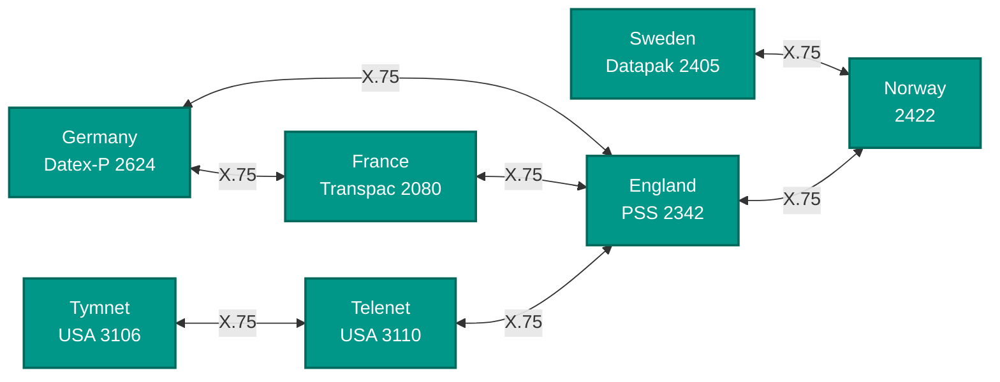

# A large demo network, made from one file

`network.ini` lists countries, the X.75 links between them, and which hosts of the library (`../hosts`) sit in
which country, each on a real host number of the time. `large.ps1` turns it into one switch file per country and
one host file, and starts it all. The three-country network in `../x75-countries` is the hand-written model this
follows; this one is generated, so it can be as large as the file says.

As shipped: seven networks, seven X.75 links, thirteen hosts.



The longest chain is four links: Sweden to Tymnet goes through Norway, England and Telenet.

## Use

```powershell
# from src\demo\large-network, after src\build.ps1
./large.ps1 start          # writes generated/, then starts every switch, echo service and the host program
./large.ps1 hosts          # every host and its number
./large.ps1 pad Norway     # a PAD on Norway's PAD line; at the * prompt: CALL 03106003604
./large.ps1 status         # what runs, by process id
./large.ps1 stop
./large.ps1 generate       # only write generated/, start nothing
```

The programs come from `src\build.ps1` (`src\publish\win-x64`); `-BinDir` names another folder, `-StateDir`
another place for `generated/`, `logs/` and the process-id file. **Always stop with the script**: it stops what it
started by process id, from the `.pids` file.

## The hosts

Every number is a real host number from the X.25 Network Atlas (`src/docs/atlas`, its source is named in each
entry), written without the leading 0 the Atlas shows: that 0 is the prefix for dialling abroad, not part of the
number. The host behind it is one of this library's, not the original machine.

| Network | Host (library folder) | Number | Atlas entry |
|---|---|---|---|
| Norway | NDOSLO (`sintran`) | 24222110000020 | Scannet NSI Nord-100, Oslo (Phrack 27/4) |
| Norway | NORDBBS (`bbs`) | 24224501340 | Bergen By Byte Mailbox (Phrack 27/4) |
| Sweden | KTH20 (`tops20`) | 240502032832 | ODEN (Phrack 21/4) |
| England | GOLD (`telecomgold`) | 23421920100481 | Telecom Gold System 81 (Phrack 27/4) |
| England | PPOA1 (`primos`) | 234223440144 | Prime R&D at Bedford (Phrack 27/4) |
| England | TOMVAX (`vax`) | 234284400108 | Culham VAX (Phrack 27/4) |
| Germany | ucbvax (`bsd`) | 26245890040262 | BDS.UNIX (Phrack 21/4) |
| Germany | ISARBOX (`maximus`) | 26245400091110 | Deutsche Mailbox 1 (Phrack 27/4) |
| France | MULTICS (`multics`) | 208078020118 | INRIA Rocquencourt Multics (Phrack 27/4) |
| Telenet | RSTSE (`rsts`) | 3110212167 | RSTS V7.0-07 (textfiles.com Telenet list; the Atlas marks it probable) |
| Telenet | AS400 (`os400`) | 31102240000083 | IBM 3708 (Phrack 42/9) |
| Tymnet | VM370 (`vm370`) | 3106003604 | VM/370 (Phrack 21/4) |
| Tymnet | MVS38J (`tso`) | 3106004580 | TSO (Phrack 21/4) |

The Atlas has no verified RSTS or AS/400 host on Telenet; those two numbers are the nearest it has.

## Dialling

- **Abroad:** the international prefix 0, then the whole number: `CALL 03106003604` reaches VM370 from anywhere.
- **At home:** the number without the DNIC: from Norway, `CALL 4501340` is NORDBBS.
- **Except** when what is left after the DNIC starts with 0 (Tymnet's `003604`, Sweden's `02032832`): the switch
  reads a leading 0 as the international prefix and looks for a network that does not exist (cleared, diagnostic
  67, invalid called address). Such a host is always dialled in full, `0` + the whole number, also at home.
- The full form with the DNIC works from every country, so it is the one to use in a test that calls its own
  country.

## What each country gets

| What | Number | TCP port (country number i, from 0) |
|---|---|---|
| PAD line, no NUI asked | callers are `<dnic>7000` + channel | 27000 + 100i + 1 |
| Echo service | `<dnic>9001` (made up, not from the Atlas) | 27000 + 100i + 2 |
| Host line | each host's own number, one exact route each | 27000 + 100i + 3 |
| Links it listens on | - | 27000 + 100i + 10, + 11, ... |
| Management console (telnet, admin / admin) | `<dnic>0000` | 9400 + i |
| Monitor | - | 4400 + i |

On the switch the ports are numbered the same way in every country: 0 the PAD line, 1 the echo, 2 the hosts,
then 3, 4, ... one per link in the order `network.ini` lists them. `show x25 port` on the console shows them so.

## Routes

A call to a country with no direct link takes the shortest chain of links (fewest countries crossed). When two
chains are equally short, the one through the link written first in `network.ini` wins. `generate` refuses a file
in which some country cannot reach another.

## The test and its report

`LargeNetworkTests` (in `src/tests/RetroX25.Tests/Demo`, category Demo, part of the normal test run) starts this
network with this script and:

1. checks the generated files: every other DNIC routed once, on a shortest chain; every host routed exactly to the
   host line; every host in `machines.ini` with its number;
2. from every country, calls every host and every echo (7 x 20 = 140 calls); a host must send its banner, an echo
   must send a typed line back;
3. reads `show x25 stats` and `show x25 port` on every switch and checks them against the calls made: the PAD line
   took 20 calls, the echo line gave out 7, the host line 7 per host; each link let out of one end what the other
   end took in; incoming = outgoing = the sum of the ports; cleared = both legs of every call; no call left up;
   packets received = sent; and over all switches each call counted once per switch it passed.

It writes `logs/test-report.md` (not in git): a summary, the links crossed between every pair of countries, every
call (from, to, full number, number dialled, links, time, what came back), and each switch's console output. The
test refuses to start while a copy started by hand runs, since the ports are the same.

## Adding to it

Add a `[country.N]`, a `[link.N]` to join it to the rest, and `[host.N]` lines, then `./large.ps1 stop` and
`./large.ps1 start`. Each host needs a `nua`: a real number from the Atlas, starting with its country's DNIC, 5 to
15 digits, not used twice and not the echo's `<dnic>9001`; `generate` refuses anything else. Never edit
`generated/`: it is written again on every start.
