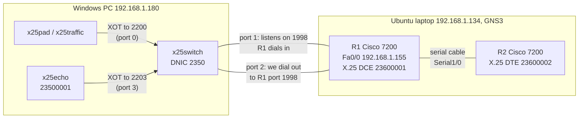
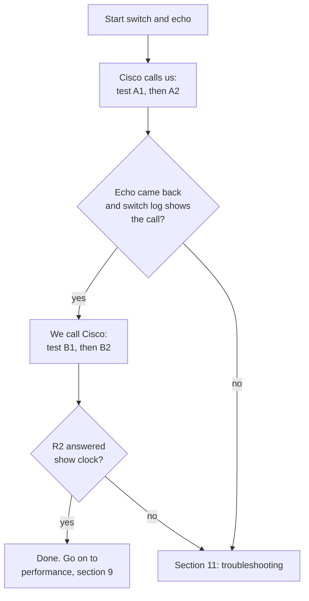
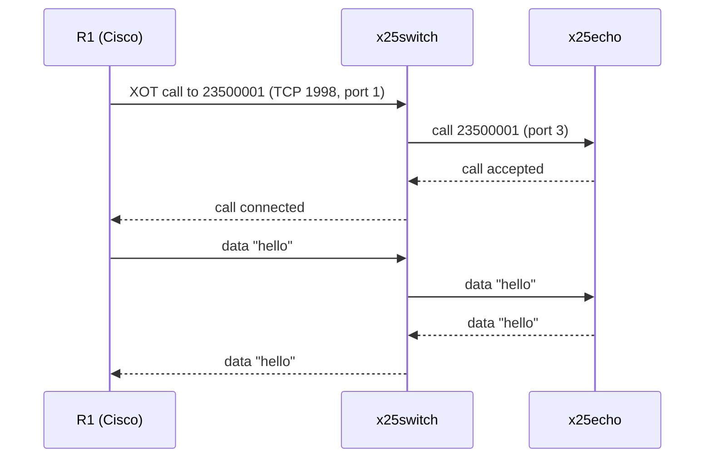
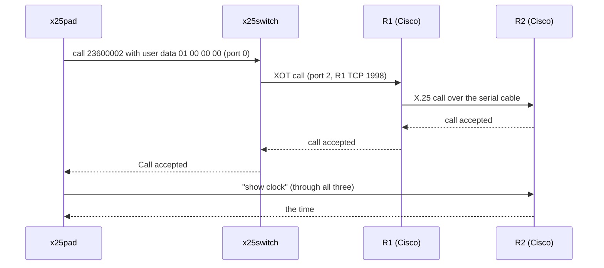
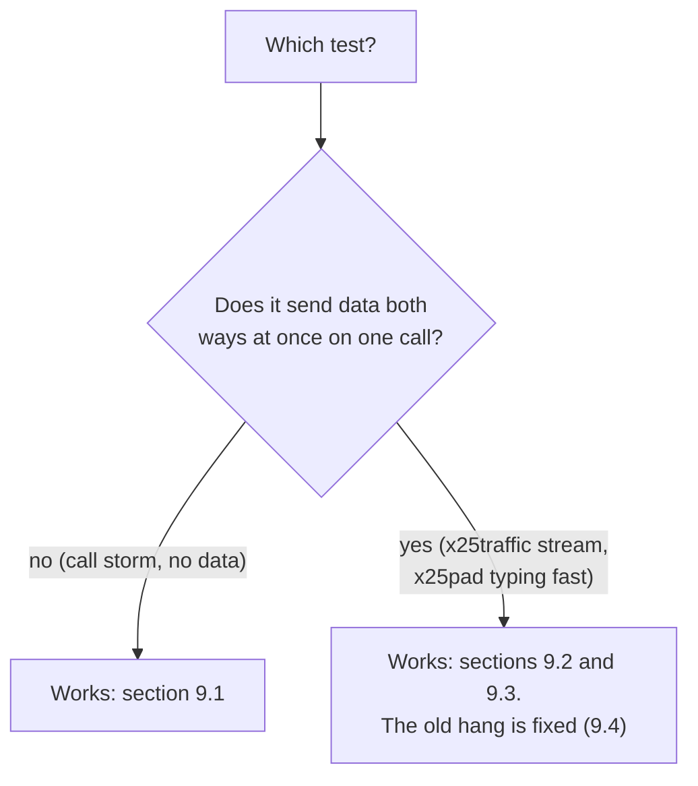
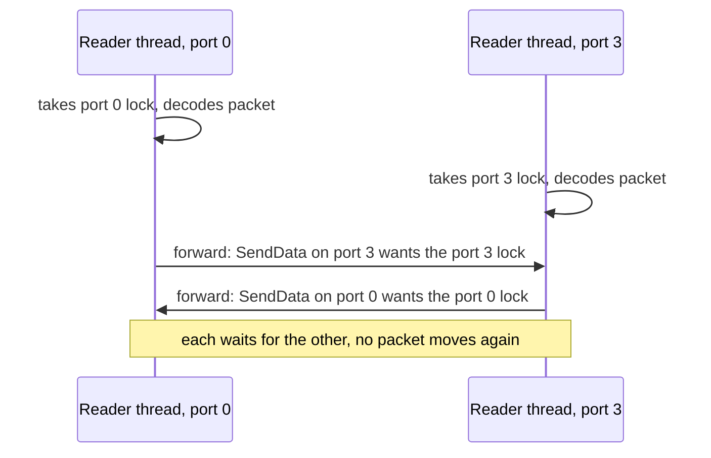
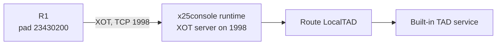
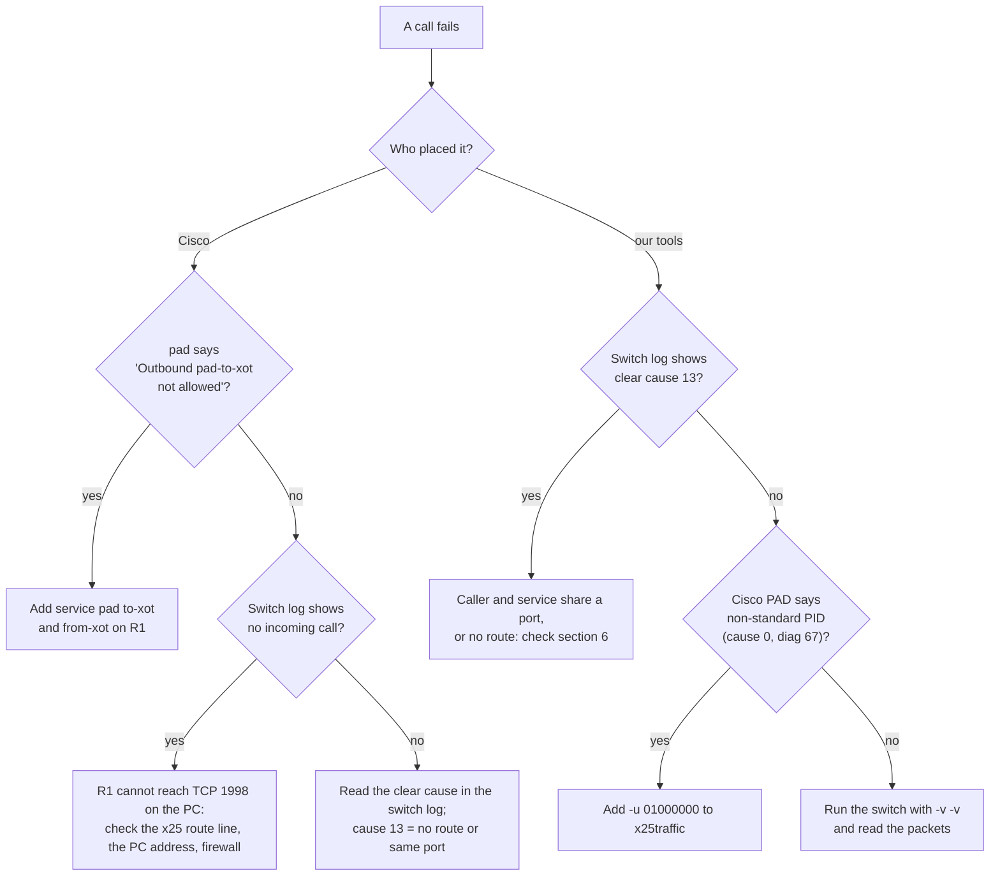

# Testing RetroX25 against real Cisco routers (GNS3 and XOT)

This page describes a test bench where two **real Cisco IOS routers** (run by GNS3) talk X.25 to
the RetroX25 switch over XOT. It was built and checked on 2026-11-10. The configuration lines below are
the ones that were running. Where a step or an output was **not** run while writing, the text says so.

**XOT** is X.25 carried inside a normal TCP connection (RFC 1613). Cisco uses TCP port **1998** for it.
A **PAD** is the part of a router (or of `x25pad`) that lets a person type at a remote X.25 host, like a
telnet client. **LCI** is the number of a virtual circuit on one link; one call has a different LCI on
each link it crosses.

## 1. What the bench proves, and what does not work yet

| # | Test | State on 2026-11-10 |
|---|---|---|
| 1 | R1 dials our echo service through our switch | Works. Checked again with the final switch file: the bytes sent came back unchanged |
| 2 | R2 (plain X.25 terminal on a serial cable) dials the echo service, going through R1 | Works. Bytes equal |
| 3 | Our `x25pad` dials R2 through our switch and R1 | Works. "Call accepted", R2 prompt, `show clock` answered |
| 4 | Our `x25traffic -u 01000000` dials R2 | Works. Call accepted, packets sent |
| 5 | Call storm to the echo service, 30 circuits | Works. 30 of 30 connected, about 500 calls a second |
| 6 | Telnet into R1 from the PC, then `pad` to the echo service | Works. See section 8, test A4 |
| 7 | `x25pad` calls R1's own address (23600001) | Works. R1 accepts, prompt `R1>`, `show clock` answered |
| 8 | R2 holds an echo call open while `x25pad` calls R2 | Works |
| 9 | A Cisco `pad` calls the TAD server of `x25console` (section 10) | Works with a current `x25console` build: banner, `HELP`, echo and `QUIT` answered, no reset. A stale build had a window fault, see section 10 |
| 10 | A burst of data packets in both directions at once (`x25traffic` to the echo service) | Works after the fix in section 9.4. 100 000 packets of 128 bytes, 100% back, about 13 Mbit/s sent. Needs the fixed switch DLL (see 9.4) |

## 2. The bench



### Addresses

| Thing | Value |
|---|---|
| Our network number (DNIC) | 2350 |
| Echo service address | 23500001 |
| Cisco network number | 2360 |
| R1 X.25 address | 23600001 |
| R2 X.25 address | 23600002 |
| Windows PC | 192.168.1.180 (from DHCP, so it can change; if it does, fix the `x25 route` line in R1) |
| R1 on the LAN | 192.168.1.155 (a free address on this LAN; pick one that is not in use) |
| Laptop | 192.168.1.134 |

### Why GNS3 runs on a Linux laptop and not on Windows

GNS3 on Windows was tried first and does not work for this. GNS3's router emulator (Dynamips) puts
its network frames onto the real LAN through Npcap. The frames it injects never reach the Windows
network stack (the adapter's packet counters stayed at 0), so the PC and the router could not talk.
Three adapters were tried (a loopback adapter, a VirtualBox host-only adapter, the WSL adapter) and
all failed. The WSL adapter is not even listed by GNS3. On the Linux laptop, bridged to its wired
network card, it worked at once.

## 3. The Linux laptop

Verified versions: Linux 7.0 (Ubuntu), GNS3 server 2.2.61.

1. Install GNS3 on the laptop. The installer asks whether non-root users may run ubridge; the
   answer must be yes.
2. **Log out and in again** after the install. Membership of the `ubridge` group only applies to a
   new login. Until then GNS3 says "uBridge is not available" (this happened on this laptop).
3. Put your own Cisco IOS image in `~/GNS3/images/IOS/`. This test used
   `c7200-adventerprisek9-mz.124-24.T5.image` (IOS 12.4(24)T5, Cisco 7200). The image is not part of
   this repository and you need your own licence for it.

## 4. The GNS3 project

Project name `X25Test`. Both routers are the same model.

| Setting | R1 | R2 |
|---|---|---|
| Template | Cisco 7200 | Cisco 7200 |
| Image | c7200-adventerprisek9-mz.124-24.T5 | the same |
| RAM / NVRAM | 512 MB / 512 KB | the same |
| Idle-PC | 0x606df838 | the same |
| Slot 0 | C7200-IO-FE (one FastEthernet port) | the same |
| Slot 1 | PA-4T+ (four serial ports) | the same |
| Console port | 5101 (GNS3 picks it; check it in the GNS3 window) | 5103 |

Idle-PC is a number that stops the emulator from using a whole CPU core while the router does
nothing. The value belongs to one image on one host. On another machine, right-click the router in
GNS3 and choose "Idle-PC finder".

Other node: **Cloud1**, a cloud object bound to the laptop's **wired network card** (on this laptop a
USB Ethernet adapter). Wi-Fi was not tried.

Links: Cloud1 (wired card) to R1 FastEthernet0/0, and R1 Serial1/0 to R2 Serial1/0.

The serial cable is what lets R2 act as a plain X.25 terminal. R2 knows nothing about XOT; R1 turns
its calls into XOT calls.

## 5. Router configuration (IOS)

For real routers (for example 25xx) and for other layouts (one router only, keepalives, calls that arrive
at the router) see `cisco-ios-x25-options.md`. This section is the configuration of the two simulated routers.

These are the startup configurations. In GNS3 the files are under
`~/GNS3/projects/X25Test/project-files/dynamips/<node id>/configs/`; you can also paste the lines into
the console. (The real files also hold the blank `!` lines and the unused default sections IOS writes
by itself; those are left out.)

### R1 (the XOT gateway)

```
version 12.4
service pad to-xot
service pad from-xot
service timestamps debug datetime msec
service timestamps log datetime msec
no service password-encryption
!
hostname R1
!
logging message-counter syslog
logging buffered 64000
no logging console
!
no aaa new-model
ip cef
no ip domain lookup
!
x25 routing
!
interface FastEthernet0/0
 ip address 192.168.1.155 255.255.255.0
 duplex half
!
interface Serial1/0
 no ip address
 encapsulation x25 dce
 x25 address 23600001
 serial restart-delay 0
 clock rate 64000
!
interface Serial1/1
 no ip address
 shutdown
!
interface Serial1/2
 no ip address
 shutdown
!
interface Serial1/3
 no ip address
 shutdown
!
x25 route ^2350 xot 192.168.1.180
x25 route ^23600002$ interface Serial1/0
x25 host R1 23600001
!
line con 0
 exec-timeout 0 0
 privilege level 15
 logging synchronous
line aux 0
 exec-timeout 0 0
 privilege level 15
line vty 0 4
 no login
!
end
```

| Line | What it does |
|---|---|
| `service pad to-xot` and `service pad from-xot` | Lets the router's PAD place calls into XOT and accept calls from XOT. **Without them** `pad 23500001` fails with "Outbound pad-to-xot not allowed", then "Destination unreachable; gateway or host down". |
| `x25 routing` | Turns the router into an X.25 switch, so it can pass calls between the serial cable and XOT. |
| `x25 route ^2350 xot 192.168.1.180` | Any call whose called address starts with 2350 goes by XOT to our switch (TCP port 1998 on the PC). |
| `x25 route ^23600002$ interface Serial1/0` | A call for exactly 23600002 goes out of the serial cable to R2. This is how calls from our side reach R2. |
| `x25 host R1 23600001` | Gives the router's own PAD an address to use as the calling address. |
| `encapsulation x25 dce` and `clock rate 64000` | R1 is the network side of the cable, so it also supplies the clock. |
| `no logging console` | Keeps debug output off the console. Read it with `show logging`. |
| `line vty 0 4` / `no login` | Anyone may open a virtual terminal without a password. This is a lab; do not copy it to a real network. |

### R2 (a plain X.25 terminal)

```
service timestamps debug datetime msec
service timestamps log datetime msec
!
hostname R2
!
no ip domain lookup
!
interface FastEthernet0/0
 no ip address
 shutdown
!
interface Serial1/0
 no ip address
 encapsulation x25
 x25 address 23600002
 serial restart-delay 0
 no shutdown
!
x25 host R2 23600002
!
line con 0
 exec-timeout 0 0
 privilege level 15
 logging synchronous
line aux 0
 exec-timeout 0 0
 privilege level 15
line vty 0 4
 no login
!
end
```

R2 has no `x25 routing` and no PAD service lines: it is an ordinary X.25 host on the end of a cable.
`encapsulation x25` with no `dce` makes it the terminal side (DTE), the opposite of R1.

## 6. The RetroX25 side

Build once, from the `src` folder:

```powershell
dotnet restore --force --no-cache
dotnet build -nodeReuse:false
```

**Why the forced restore.** RetroX25 takes RetroIO from local packages named `0.1.0-local.<time stamp>`
(made by RetroIO's `eng/publish-local.ps1`). A plain restore kept an older stamp once, and the programs
then ran old RetroIO code (an old switch that freezes, an old `x25console` that broke the TAD window).
Check which stamp you got: `Select-String RetroX25.Switch\obj\project.assets.json -Pattern 'X25.Switch/'`.

### The five-minute check (do this first)

Everything is on the PC except the routers. Three terminals, from `src`:

1. `dotnet RetroX25.Switch\bin\Debug\net10.0\x25switch.dll demo\switch-cisco.ini`
2. `dotnet RetroX25.Echo\bin\Debug\net10.0\x25echo.dll -a 23500001 -x 127.0.0.1:2203 -q`
   (`-q` = quiet, a plain echo. **Needed for the burst test:** without it the echo service greets every
   caller, which is one packet the traffic tool did not send, so it would count one more packet back than
   it sent. For typing at it from a PAD, start it without `-q`: it then says "Welcome to the echo server.
   Type exit to leave." and hangs up when you type `exit` or press Ctrl-D.)
3. A burst test: `dotnet RetroX25.Traffic\bin\Debug\net10.0\x25traffic.dll -x 127.0.0.1:2200 -d 23500001 -n 50000 -r 0`

Pass: the last lines say `Delivery: 100.0%`, in a few seconds. If it hangs, you have an old RetroIO
package (see above). Then the router test: open R1's console (section 7) and type `pad 23500001`, then
`hello` and Enter. Pass: `hello` comes back. Leave with Ctrl-^ then `x`, then `disconnect` and Enter.
The full list of tests, with what to expect, is section 8.

### The switch file

`src/demo/switch-cisco.ini` has four ports and three routes:

| Port | Role | What it is for |
|---|---|---|
| `port.0` | access, XOT, listens on 2200 | Callers: `x25pad` and `x25traffic` connect here |
| `port.1` | trunk, XOT, listens on 1998 | R1 dials in here (this is where R1's `x25 route ... xot` lands) |
| `port.2` | trunk, XOT, connects out to 192.168.1.155 port 1998 | We dial R1 here, for calls to 2360... |
| `port.3` | access, XOT, listens on 2203 | The echo service connects here |

| Route | Calls for | Go to |
|---|---|---|
| `route.2`, exact | 23500001 | port 3 (the echo service) |
| `route.0`, network number | 2350... | port 0 |
| `route.1`, prefix 2360 | 2360... | port 2 (R1) |

**Why the echo service has its own port.** The switch joins a call that comes in on one port to a call
that goes out on another. A caller and a service on the *same* port can never be joined: the switch
clears the call with cause 13 ("not obtainable"). So the callers share port 0 and the echo service
sits alone on port 3. Most specific route wins, so the exact route for 23500001 beats the 2350 route.

If R1's LAN address is not 192.168.1.155, change `host` in `port.2`.

### Start the pieces (from `src`, in two terminals)

```powershell
dotnet RetroX25.Switch\bin\Debug\net10.0\x25switch.dll demo\switch-cisco.ini
dotnet RetroX25.Echo\bin\Debug\net10.0\x25echo.dll -a 23500001 -x 127.0.0.1:2203
```

The switch takes the ini path as its first argument (there is no `-c`). Add `-v -v` after it to log every
packet in hex, which is what you want when something does not work. R1 has to reach TCP 1998 on the PC;
if a firewall blocks that, allow it.

## 7. Reaching the router consoles

GNS3 on the laptop listens only on the laptop. From the PC make a tunnel (here from WSL):

```bash
ssh -N -L 5101:127.0.0.1:5101 -L 5103:127.0.0.1:5103 <user>@192.168.1.134
```

Then open a plain telnet-style connection to `localhost:5101` (R1) or `localhost:5103` (R2). The
RetroTerm terminal works.

Habits worth knowing:

- Run `terminal length 0` first, or long output stops at `--More--`.
- If a PAD call is open, **Enter resumes it**. To leave a call without clearing it press
  Ctrl-^ then `x`. To end it, then type `disconnect` and press Enter again at the confirm prompt.
  (Checked on R1: that sequence returned to `R1#`.)
- Debug output is not on the console (`no logging console`); read it with `show logging`.

## 8. Manual tests, both directions

Do the steps in order. After each one, "what you should see" tells you if it worked. Where it says
**not run**, nobody has tried that exact step, so a difference is information, not necessarily a fault.

First start the switch and the echo service (section 6) and open the consoles (section 7).



### Direction A: the Cisco calls us



**A1. R1 calls the echo service.** On R1:

```
R1#terminal length 0
R1#pad 23500001
```

You should see `Trying 23500001...Open`. Type a line and press Enter. The same bytes go to the echo
service and come back. (On 2026-11-10 `hello via new route` plus Enter went out and came back byte for byte;
the switch log with `-v -v` showed the same bytes on port 3 and port 1.) Then leave: Ctrl-^, `x`,
`disconnect`, Enter.

In the switch log you should see `Port 1: incoming call 23600001 -> 23500001`, then `Port 3: call accepted`.

**A2. R2 calls the echo service, through R1.** On R2:

```
R2#pad 23500001
```

Same result. The call goes R2, serial cable, R1, XOT, switch, echo. In the switch log you should see
`Port 1: incoming call 23600002 -> 23500001`, and the bytes you type come back (checked: `from r2` plus Enter).

**A3. A call to an address nobody has.** Two cases, both checked on R1:

- `pad 23999999` (no route on R1): R1 prints `% Connection refused by remote host` and the switch
  never sees the call.
- `pad 23500099` (R1 sends it to the switch, which has no one on that address): the switch logs
  `incoming call 23600001 -> 23500099` then `clear LCI=1 cause=13`, and R1 prints the same
  `% Connection refused by remote host`.

**A4. Telnet into R1, then `pad` to the echo service.** This is how a person on another machine uses the
router's PAD: they telnet to the router, not to the X.25 network. From the PC (RetroTerm, PuTTY or any
telnet client) open a telnet connection to **192.168.1.155**, port 23. R1's virtual terminal lines have no
password (`no login`), so you land at once in user mode:

```
R1>pad 23500001
Trying 23500001...Open
```

Type a line and press Enter: the same bytes come back from the echo service (checked: the switch log shows
`telnet test line` plus CR going out on port 3 and coming back on port 1). On screen you may see the line only
once, because the echoed copy is drawn over the one you typed.

Leave the call with Ctrl-^ then `x` (this works over telnet; checked). You are back at `R1>` and the call is
still open; `show x25 vc` shows it, for example `23600001 connected to 23500001 PAD <--> XOT 192.168.1.180,1998`
with the byte counts. End it with `disconnect` and Enter at the confirm prompt, and close the telnet
session with `exit` (checked).

User mode is enough: `pad`, `show x25 vc`, `show x25 route` and the `show interfaces` line all ran from `R1>`.
`debug`, `clear logging` and `configure terminal` do not (they need the console or `enable`).

The same works for R2 only through its console (5103): its FastEthernet port is shut down, so it has no
telnet address.

### Direction B: we call the Cisco



**B1. `x25pad` calls R2.** In a normal Windows terminal (`x25pad` needs a real terminal; it reads single keys):

```powershell
dotnet RetroX25.Pad\bin\Debug\net10.0\x25pad.dll -x 127.0.0.1:2200
```

At its prompt type:

```
CALL 23600002
```

You should see `[Connected] Call accepted` and then R2's prompt `R2>`. Type `show clock`; R2 answers with
the time (on 2026-11-10: `*18:32:55.287 UTC Tue Nov 10 2026`). In the switch log the call request carries the four bytes
`01 00 00 00` after the addresses. That is the X.29 marker, the first four bytes of call user data. Cisco's
PAD refuses a call without it.

**B2. `x25traffic` calls R2.** From `src`:

```powershell
dotnet RetroX25.Traffic\bin\Debug\net10.0\x25traffic.dll -x 127.0.0.1:2200 -d 23600002 -u 01000000 -n 5 -r 2
```

You should see `Connected.` and a results block. Leave out `-u 01000000` and R2 refuses the call
(`Call failed`; R2's debug says `pad_svc_announce: non-standard PID`; cause 0, diagnostic 67).
The "Delivery" percentage is meaningless here: a PAD answers with its own echoes and prompts, so a run
showed 700% (35 packets back for 5 sent).

**B3. `x25pad` calls R1 itself (23600001).** Same steps as B1 with `CALL 23600001`. Checked: R1 accepts
the call, shows `R1>`, and `show clock` is answered. (R1 has no PAD route for its own address, and still
accepts it.)

### Calls at the same time

Checked: R2 held an echo call open (A2, typed `from r2`) while `x25pad` called R2 (B1) and then R1 (B3).
Both worked while the echo call stayed up. That test sends only one packet at a time. The
burst test that used to hang the switch is in 9.2.

## 9. Performance and long-running tests

### What is known today



### 9.1 Call set-up rate (works)

```powershell
dotnet RetroX25.Traffic\bin\Debug\net10.0\x25traffic.dll -x 127.0.0.1:2200 -d 23500001 -C -n 30 -r 0 -p 0
```

`-C` opens many circuits, `-n` is how many, `-r 0` is as fast as possible, `-p 0` sends no data on them.
Read the "Call Storm Results" block. **Measured 2026-11-10 on this bench: 30 circuits opened, 30
connected, 0.06 s, 503 calls a second.** The "Teardown" figure is not a real rate: the tool sleeps
500 ms at the end to let the clears drain, so a short run always shows about half a second.

**Keep `-n` at or below the port's circuit count.** Port 0 has `lci_count = 64`. A run with `-n 500`
connected **0 of 500** and took 77 seconds. It was not shown that the circuit count is the reason (it
was only seen next to the failure), so raise `lci_count` to 2048 in the ini first and compare.

### 9.2 Throughput

The test (run it with a switch file that has `lci_count = 2048` on the access ports):

```powershell
dotnet RetroX25.Traffic\bin\Debug\net10.0\x25traffic.dll -x 127.0.0.1:2200 -d 23500001 -n 20000 -r 0
```

Call the **echo service**, not R2. The echo service returns every packet, so "Delivery" is a true
percentage and should be 100%. Calling R2's PAD cannot give you a delivery figure. Vary `-s` (packet
size, up to 128) and `-r` (packets per second).

**Measured 2026-11-10** (everything on the Windows PC, switch, echo and traffic tool, over loopback, no
Cisco in the path):

| Run | Sent | Back | Delivery | Rate sent |
|---|---|---|---|---|
| `-n 20000 -r 0` (128-byte packets, full speed) | 20 000 | 20 000 | 100% | 16.9 Mbit/s |
| `-n 100000 -r 0` | 100 000 | 100 000 | 100% | 13.4 Mbit/s (11.1 Mbit/s back) |
| `-n 100000 -r 0 -s 16` (16-byte packets) | 100 000 | 100 000 | 100% | 2.2 Mbit/s |
| `-n 3000 -r 50` (paced) | 3 000 | 3 000 | 100% | 33 Kbit/s |

No resets, no clears except the normal ones when each run ended.

Two things to know when you read the numbers:

- **The paced run reached about 32 packets a second, not the 50 asked for.** The tool waits with
  `Sleep(1)`, which lasts about 15 ms on Windows. It is a limit of the tool, not of the switch.
- **Two faults in our own tools were found and fixed while measuring, and they had made earlier
  figures wrong.** `x25echo` threw away an echo whenever its send window was full (about a third of all
  echoes at full speed, with no error shown). `x25traffic` printed its results before the last echoes had
  come back, so "delivery" was too low. The echo tool now queues and retries, and the traffic tool waits
  until the echoes stop arriving (at most one second of silence) before it prints.

### 9.3 Long-running (soak) tests

Measured so far: a paced run of 3 000 packets at the requested 50 a second (about 32 a second in fact,
see 9.2) ran 93 seconds with 100% delivery. A longer run on the earlier build (60 seconds, 3 000 of 3 000
delivered) showed the switch's memory flat at about 48 MB. Hours-long runs have not been done.

**One call that stays up for hours**, 10 packets a second, until you press Ctrl-C:

```powershell
dotnet RetroX25.Traffic\bin\Debug\net10.0\x25traffic.dll -x 127.0.0.1:2200 -d 23500001 -n 0 -r 10
```

It prints a line every 2 seconds: packets sent and received. What to look for: the two counts keep growing
in step; the call does not clear (the tool stops by itself if the call clears); the switch log shows
no `clear`, `reset` or `connection down` lines.

**Many short calls, over and over** (finds leaks that one long call cannot):

```powershell
while ($true) {
  dotnet RetroX25.Traffic\bin\Debug\net10.0\x25traffic.dll -x 127.0.0.1:2200 -d 23500001 -C -n 50 -r 0 -p 0 |
    Select-String 'VCs opened'
  Start-Sleep -Seconds 5
}
```

Every line should say `50 connected, 0 failed`. A line with fewer connected means circuits are not
being given back. Stop it with Ctrl-C.

**Watch the switch while a soak runs.** Find its process id in Task Manager (a `dotnet` process whose
command line has `x25switch`) and read it now and then:

```powershell
Get-Process -Id <pid> | Select-Object Id, WorkingSet64, Threads, Handles
```

A working set, thread count or handle count that keeps climbing after the first few minutes is a leak.

**Through the Cisco.** Run the first soak above against R2 (`-d 23600002 -u 01000000`) to keep a call
open through R1 for hours. Packet counts will not match (the PAD answers with its own bytes); the
useful checks are that the call stays up and that R1 stays healthy: `show x25 vc` on R1 (standard IOS
command, not run here) and `show processes cpu` on the laptop's side. Note that Dynamips runs the
router in software on the laptop, so the router, not our switch, may be the slowest part of any test that
goes through it. This was not measured.

### 9.4 The old switch hang (fixed)

**State.** Fixed in RetroIO (`XotSwitchPort.cs`): all XOT ports now share one lock, so two ports can no
longer wait for each other. A new test, `DataFlowingBothWaysAtOnce_DoesNotFreezeTheSwitch`, sends 300
packets each way at once and passes; the whole X.25 test project passed (961 tests, 0 failed). **The
change was packed into the local RetroIO package `0.1.0-local.20261110210003` and checked from a normal
RetroX25 build: 50 000 packets of 128 bytes through the switch, 100% back, 14 Mbit/s.** If a build of yours
still hangs, it has an older package: run `dotnet restore --force --no-cache` in `src` (a plain restore
kept the older `local` package), then build again.

One thing to know: if a port has to dial out (a trunk port that connects to a router) while the shared
lock is held, a slow connect delays traffic on the other ports. A dialling port normally keeps a spare
connection open, so this was not seen.

What was found, kept for the record:

**What happened.** Send a burst of data packets through the switch to a service that answers
(`x25traffic` to the echo service). After a few packets nothing moves any more. `x25traffic` shows
`Sent` and `Recv` counts that stop changing, for example 18 sent and 6 received for the rest of the
minute. The same stall was seen through R1 (8 sent, 2 received). The switch writes no error.

**What the packet log shows** (`-v -v`): the echo's reply arrives on port 3 and the caller's next
packet arrives on port 0 at the same moment, and then the log is silent in both directions.

**Where it came from (proven with a thread dump: two threads blocked in `SendData`).** In
`XotSwitchPort.ReadUntilClosed` (RetroIO, `RetroIO.Protocols.X25.Switch`), the reader thread of a port
holds that port's lock while it hands each received packet to the switch core. The core forwards it by
calling the *other* port's `SendData`, which takes the other port's lock. When both ports receive at
once, each thread waits for the lock the other holds. They wait for each other forever.



A one-way test (R1 calls the echo service and types a line) never meets it, because only one packet
is on the way at a time. That is why tests 1 to 4 work.


## 10. The built-in TAD server (more fun than the echo service)

The `x25console` and `RetroX25.exe` (Desktop) programs run a full RetroX25 runtime. That runtime has an XOT
server (it listens for XOT calls itself, like a Cisco router would) and a built-in **TAD** service on a "LocalTAD"
route. TAD answers a PAD call with a banner, takes commands (`HELP`, `STATUS`, `QUIT`) and
echoes other text (checked from R1, see below). It speaks
X.29, the same protocol the Cisco PAD uses, so a Cisco router can call it directly.

(There is a second thing also called TAD, the SINTRAN XMSG one. That is a different protocol and a Cisco router
cannot reach it. This section is only about the X.25 TAD above.)

### How it was wired up (checked on 2026-11-10)



The TAD runtime listens on **1998**, the same port our switch's trunk port uses, so run **either** the switch
or the TAD runtime, not both, on this PC. Going through the switch was not tried.

1. Stop the switch and the echo service (port 1998 must be free).
2. Make a config file from `src/docs/config-samples/x25config-xot-test.json`: keep only the `Server` entry
   under `XotInterfaces` and only the two `LocalTAD` entries under `RoutingTable`. (The sample's address
   23430200 and the pattern `2343.*` are the TAD's addresses.)
3. Start it, from `src`: `dotnet RetroX25.Console\bin\Debug\net10.0\x25console.dll <your config>.json`.
   It draws a text screen, so start it in a normal terminal window. The listener comes up on port 1998.
4. On R1, add a route to it (and remove it afterwards):

```
R1#configure terminal
R1(config)#x25 route ^2343 xot 192.168.1.180
R1(config)#end
R1#pad 23430200
```

### What happens

With an up-to-date build of `x25console` the call works. R1 prints the whole banner, ends on the `TAD>`
prompt, and the commands are answered (checked 2026-11-10 from R1):

```
R1#pad 23430200
Trying 23430200...Open
*** X.25 TAD Loopback Echo Service ***
Connected to address 23430200
Type 'HELP' for commands, 'QUIT' to exit
All text will be echoed back to you
TAD> HELP
*** X.25 TAD Server Help ***
...
TAD> hello cisco 42
Echo: hello cisco 42
Analysis: 14 chars, numeric, alphabetic
TAD> QUIT
```

`QUIT` clears the call normally (R1's log shows a Clear and a Clear Confirm, no Reset).

**Two defects were seen on that run, and both are fixed (checked 2026-11-10 from R1).** A stray `~` appeared
before the banner, and typed characters showed twice (`HELP HELP`, `hello cisco 42co 42`). The cause was that
the TAD built its own X.25 packets and the runtime re-sent only their data, so the TAD's X.29 SET (the
`~` is 0x7E, the value of X.3 parameter 3) went out without the Q bit and the router printed it as text and
kept its own echo on. The TAD now hands the runtime plain "send this data, with these Q/M/D bits" requests,
and the XOT circuit's one packet engine builds the packets. With that build, from R1:

```
R1#pad 23430200
Trying 23430200...Open
*** X.25 TAD Loopback Echo Service ***
...
TAD> HELP
*** X.25 TAD Server Help ***
...
TAD> hello cisco 42
Echo: hello cisco 42
```

No `~`, each typed line shown once, and `QUIT` ends the call. A unit test
(`TadOverXotQBitTests`) calls the TAD over a real XOT connection and checks the SET has the Q bit, the banner
has no stray bytes and the long banner carries the M bit. `debug x25 xot` was not switched on for the router run.

### The window fault seen first, and why it is gone

The first try used an `x25console` build whose RetroIO libraries were dated 4 September. R1's own debug
(`debug x25 events`, `debug x25 xot`, then `show logging`) showed the fault:

```
XOT I D1 Data (12) Q 8 lci 1 PS 0 PR 0
XOT I D1 Data (131) 8 lci 1 M PS 1 PR 0
XOT I D1 Data (30) 8 lci 1 PS 2 PR 0
XOT Data packet, Bad P(S), Receive window violation
XOT O D1 Reset (5) 8 lci 1
  Cause 5, Diag 1 (Local procedure error/Invalid P(S))
```

R1 asked for a window of 2, the old build sent three packets in a row, and R1 reset the circuit. The current
RetroIO source has one packet layer that owns the window (the RetroIO changes of 6 September), and a rebuild
of `x25console` against it removed the fault: same router, same route, no Reset, no window violation.
**The fix was therefore already in RetroIO; the old build was stale.** Lesson for the bench: after any
RetroIO change, rebuild the RetroX25 programs (`dotnet build` in `src`) before reading a result.
Clean-up after the test: `no x25 route ^2343 xot 192.168.1.180` on R1 (checked: `show x25 route` is back to the
two original routes), and stop `x25console`. After stopping it, R1 still listed the dead circuit for a short
while; whether and when it disappears by itself was not watched.

## 11. Troubleshooting



| Symptom | Cause | Fix |
|---|---|---|
| GNS3 says "uBridge is not available" | Group change not applied to the running session | Log out and in |
| `pad`: "Outbound pad-to-xot not allowed" | PAD service for XOT is off | The two `service pad` lines on R1 |
| `x25 route ... alias` rejected | Not a valid keyword in this IOS | Use a second router instead |
| A router calling its own address over XOT | Refused | Use R2, as in this bench |
| Serial port looped back to itself | LAPB stayed in SABMSENT, never came up | Use R2 |
| Switch exits at once, "Could not find file -c" | The switch has no `-c` option | Give the ini path as the only argument |
| Switch clears every local call with cause 13 | Caller and service on the same port | Give the service its own port and an exact route |
| `x25traffic` call refused by a Cisco PAD | No call user data | Add `-u 01000000` |
| Data stops after a few packets | The old switch hang (9.4) | Use a switch built with the fixed RetroIO |

## 12. Checking the router side

All of these were run on 2026-11-10; the output shown is what the bench printed.

```
R1>show interfaces serial 1/0 | include LAPB|line protocol
Serial1/0 is up, line protocol is up
  LAPB DCE, state CONNECT, modulo 8, k 7, N1 12056, N2 20

R2#show interfaces serial 1/0 | include LAPB|line protocol
Serial1/0 is up, line protocol is up
  LAPB DTE, state CONNECT, modulo 8, k 7, N1 12056, N2 20

R1>show x25 route
  #  Match                         Substitute          Route to      match/use
  1  dest ^2350                                        xot 192.168.1.180
  2  dest ^23600002$                                   Serial1/0
```

(The real output also has the match/use counters at the right of each route; they are left out here.)

`show x25 vc` lists open calls (an example is in test A4). On R2 it prints nothing when no call is open.
For debug, on the console: `debug x25 events` and `debug x25 xot`, make the call, `undebug all`, then
`show logging | begin Log Buffer` (the router has `no logging console`, so the output goes to the buffer).
Use `clear logging` first to start from an empty buffer.

## 13. Other limits

- The switch once logged `Cannot access a disposed object ... NetworkStream` when a trunk connection was
  closed by hand. It has not been investigated.
- The Windows PC's address comes from DHCP. If it changes, change `x25 route ^2350 xot ...` on R1.
- `x25traffic` against a Cisco PAD proves call set-up and data flow only. For delivery rates use the
  echo service.
