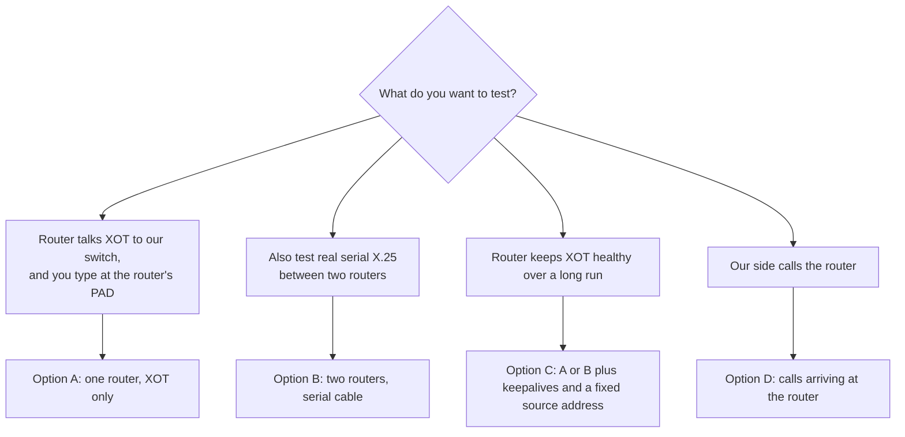
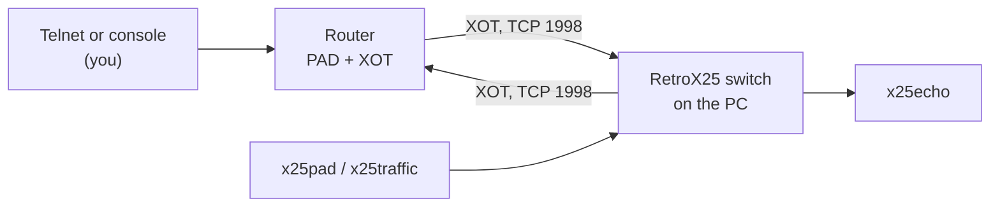
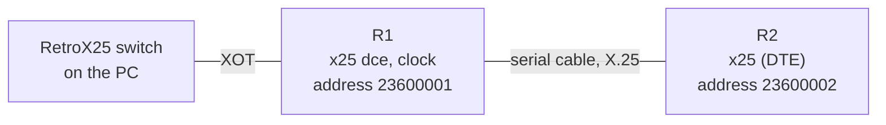
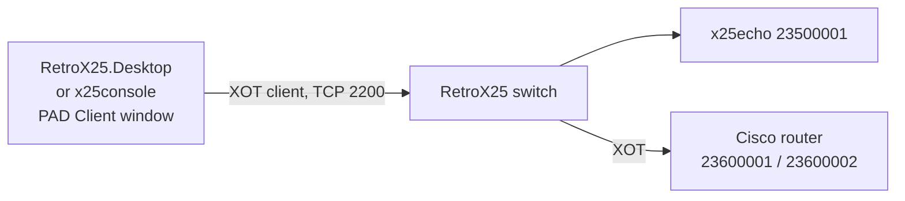

# Cisco IOS and X.25: setup options for real routers (25xx and similar)

This page is for putting RetroX25 against **real Cisco hardware**, for example a pair of 25xx routers.
It lists several ways to set the routers up, with the IOS configuration for each, what each one tests,
and how to check it.

**How much of this has been tested.** Read the label on each part:

| Label | Meaning |
|---|---|
| **Tested** | Run on our GNS3 bench (two simulated 7200 routers, IOS 12.4(24)T5). Details in `cisco-gns3-xot-test.md`. |
| **From Cisco** | Copied from a Cisco document (linked at the end). Not run by us. |
| **Not verified** | Our best understanding. **Not run, and not found in a source.** Check it on the router before you trust it. |

Nothing here has been run on a real 25xx. Where a 25xx may differ (interface names, memory, image
names) it says so.

## 1. What you need

### For every option

- A router with an IOS image that has **X.25** and **XOT** (X.25 over TCP). Cisco says XOT has been in IOS since
  9.21 and that the `xot` keyword in `x25 route` is for IOS 11.3 and later; older releases write `ip` instead
  of `xot` (**From Cisco**). Cisco's example page says "with any feature set" (**From Cisco**). Whether a
  given 25xx image in your hands has it is **not verified**: on the router, type `x25 routing` in
  configuration mode and `show x25 ?`. If the router says "% Invalid input", the image has no X.25.
- A way to reach the console (a rollover cable and a serial port on the PC, or a USB adapter).
- The PC that runs the RetroX25 switch, on the same IP network as the router. The router must reach
  **TCP port 1998** on the PC (XOT's port).

### Extra for the serial options (B, D)

- Two routers and a **cable pair** that makes one router the network side (DCE) and the other the terminal
  side (DTE). The DCE end supplies the clock. How the cables are wired, and which of your cables is which, is
  **not verified**: look at the cable label, and `show controllers serial 0` on the router says what it sees
  (DTE or DCE).

### Before you start: look at the router

Run these on each router and write the answers down. They decide what you can do.

```
show version
show flash
show ip interface brief
show controllers serial 0
```

| Look for | Why |
|---|---|
| IOS version and image name in `show version` | X.25 and XOT must be in it. The image name says the feature set. |
| DRAM and Flash sizes | A feature-rich image will not fit a small Flash or DRAM. A search found only general 2500 figures (8 MB Flash normal, 4 MB on some models, up to 16 MB; DRAM 4, 8 or 16 MB) and **no figure for X.25 or XOT images**. Use Cisco Feature Navigator or try the image. |
| Interface names | Cisco's own 2500 examples use `Serial0`, `Serial1` and `Ethernet0`. Your model may differ (**not verified**). Replace the names in the examples below with yours. |
| LAN port type | Some 25xx models have an AUI Ethernet port that needs a transceiver (**not verified** for your model). |

## 2. The four options at a glance



| Option | Routers | Cable between routers | Tests | Label |
|---|---|---|---|---|
| A. One router, XOT only | 1 | no | calls to and from our switch over XOT, the router's PAD, telnet to the PAD | Tested on the bench (R1 without the serial part) |
| B. Two routers, serial cable | 2 | yes | everything in A, plus real X.25 packet layer on a serial line, calls forwarded between line and XOT | Tested on the bench (R1 + R2) |
| C. Keepalives and source address | 1 or 2 | as A or B | a long run; what happens when the TCP connection dies | From Cisco |
| D. Calls that arrive at the router | 1 or 2 | as A or B | our side calls the router's own address or a host behind it | Tested (via R1 and R2) |

On every option the PC runs the same RetroX25 pieces; see `cisco-gns3-xot-test.md` section 6 and its
"five-minute check". The switch file is `src/demo/switch-cisco.ini`; change the `host` in `port.2` to your
router's address.

## 3. Option A: one router, XOT only



This is the router from the bench without the serial part. Replace `FastEthernet0/0` with your LAN
interface, and the addresses with yours. **Tested** (on 12.4; syntax on an older 25xx image is **not verified**).

```
hostname R1
!
service pad to-xot
service pad from-xot
!
x25 routing
!
interface Ethernet0
 ip address 192.168.1.155 255.255.255.0
 no shutdown
!
x25 route ^2350 xot 192.168.1.180
x25 host R1 23600001
!
line vty 0 4
 no login
end
```

| Line | What it does |
|---|---|
| `service pad to-xot` / `from-xot` | Without them the router's PAD cannot call into XOT: `pad` says "Outbound pad-to-xot not allowed". **Tested.** On an old image the commands may not exist (**not verified**). Check with `service pad ?`. |
| `x25 routing` | Lets the router switch X.25 calls between its interfaces and XOT. |
| `x25 route ^2350 xot 192.168.1.180` | A call whose called address starts with 2350 goes by XOT to the PC. Cisco's own form: `x25 route ^xxxx xot a.b.c.d` (**From Cisco**). |
| `x25 host R1 23600001` | Gives the router's own PAD a calling address. **Tested.** |

**What calls to our switch need.** The switch must accept R1's call on a port that is a "trunk" and listens on
1998 (`port.1` in `switch-cisco.ini`), and have a route for the called address (23500001 goes to the echo
service). That is already in `switch-cisco.ini`.

**Test it** (full steps and expected output in `cisco-gns3-xot-test.md` section 8, tests A1 and A4):

1. On the router: `pad 23500001`, type `hello`, Enter. `hello` comes back from the echo service.
2. Leave the call: Ctrl-^ then `x`, then `disconnect` and Enter at the confirm.
3. From the PC: telnet to the router, then `pad 23500001`. (Telnet to the PAD works from user mode. **Tested.**)

## 4. Option B: two routers and a serial cable



The bench layout. R1 is the same as in option A, plus the serial interface. R2 is an ordinary X.25 host.
**Tested** on 12.4. On a real pair, put the DCE end of the cable on R1 and set the clock there.

R1 (additions to option A):

```
interface Serial0
 no ip address
 encapsulation x25 dce
 x25 address 23600001
 clock rate 64000
 no shutdown
!
x25 route ^23600002$ interface Serial0
```

R2:

```
hostname R2
!
x25 host R2 23600002
!
interface Serial0
 no ip address
 encapsulation x25
 x25 address 23600002
 no shutdown
```

| Point | Detail |
|---|---|
| Which side is DCE | `encapsulation x25 dce` on one end, plain `encapsulation x25` on the other. Cisco's example puts `clockrate` (spelled as one word on some versions, two on others, **not verified** which your image takes) on the DCE interface only (**From Cisco**). |
| The clock | The DCE end sets it. If both ends say `dce`, or neither supplies a clock, the line stays down. Check: `show interfaces serial 0` should say "line protocol is up". |
| Speed | `64000` worked on the bench. On real serial, any speed the cable and port support may be used (**not verified** for your cable). |
| Address rule | Our switch calls R2 with a called address of 23600002; the route `^2360` on our switch sends it to R1, which routes `^23600002$` out of `Serial0`. |

**Test it:** tests B1 to B3 in `cisco-gns3-xot-test.md` section 8. In short: `x25pad` on the PC, `CALL 23600002`,
"Call accepted", then the R2 prompt.

**Calls from R2 to us:** on R2 type `pad 23500001`. R2 sends the call to R1 over the cable; R1 routes it by
XOT to our switch (**Tested**, test A2).

## 5. Option C: keepalives and a fixed source address

For a long run. All from Cisco's XOT keepalive document (**From Cisco**), not run by us.

```
x25 route ^2350 xot 192.168.1.180 xot-keepalive-period 10 xot-keepalive-tries 3 xot-source Loopback0
!
interface Loopback0
 ip address 10.255.255.1 255.255.255.255
```

| Setting | What Cisco says |
|---|---|
| Default | Keepalives are always on, the period is 60 seconds, and 4 tries are made. |
| `xot-keepalive-period 10`, `xot-keepalive-tries 3` | Check every 10 seconds, give up after 3 missed. |
| `xot-source Loopback0` | The TCP connection uses the loopback's address as source, so it survives if one of several physical interfaces fails. |
| When the TCP connection dies | The X.25 circuit is cleared as well. The router prints "XOT cx closed" and sends a Clear on the serial side. |

The router's own TCP keepalives (`service tcp-keepalives-in` and `-out`) appear in Cisco's example too
(**From Cisco**). Use them if a circuit stays "up" after the PC has gone away.

**Test it** (**not verified**, a suggestion): start a long call (`x25traffic ... -n 0 -r 10`, see
`cisco-gns3-xot-test.md` 9.3), then stop the switch on the PC. Expect the router to clear the circuit within
period times tries. Start the switch again and place a new call.

## 6. Option D: calls that arrive at the router

Our side can call the router's own PAD, or a host behind the router.

| Call from the PC | Goes to | Needs | Label |
|---|---|---|---|
| `x25pad`, `CALL 23600001` | R1's own PAD (prompt `R1>`) | the call reaches R1 over XOT: on our switch a route for `2360` to the trunk that dials R1 (`port.2`) | **Tested** |
| `x25pad`, `CALL 23600002` | the PAD of R2, through R1 and the cable | option B | **Tested** |
| `x25traffic -u 01000000 -d 23600002` | R2, sends data | `-u 01000000` is the call user data a Cisco PAD wants (the X.29 marker); without it R2 clears the call | **Tested** |

On our switch `port.2` is a "dialling" port: it connects out to the router's TCP port 1998 when a call needs it.
That is why the router's address is in `switch-cisco.ini` (`host` in `port.2`).

## 6b. Testing with the UI apps

The same tests can be done from the two UI programs instead of `x25pad`. **Not verified:** none of this
was run; the config file below was only written, not loaded. Tell us which step fails.

| Program | What it is | How to start |
|---|---|---|
| `RetroX25.Desktop` | Windows desktop application (Avalonia): PAD Client window, Packets window, Routes, XOT interface editor | `dotnet run --project RetroX25.Desktop` from `src`, in a Windows desktop session |
| `RetroX25.Console` | The same stack in a text screen | `dotnet RetroX25.Console\bin\Debug\net10.0\x25console.dll <config>.json` in a real terminal window |

**The idea.** The UI app is a caller. It opens one XOT connection to our switch (caller port 0, TCP 2200)
and sends every call for 2350... and 2360... down it. The switch then does what it does for `x25pad`:
2350... goes to the echo service, 2360... goes to the Cisco router.



**Config.** `docs/config-samples/x25config-xot-to-switch.json` has the one XOT client interface
(`127.0.0.1:2200`) and the two routes (`2350.*` and `2360.*` to it). Its own address is 99990002. If the
switch is on another PC, change `RemoteIPAddress`.

- **Console:** `dotnet RetroX25.Console\bin\Debug\net10.0\x25console.dll docs\config-samples\x25config-xot-to-switch.json`
  (the program takes the config path as its argument; **checked** in the source).
- **Desktop:** in the app, open Configuration → XOT Interfaces and add the same client interface (name
  `XOT_ToSwitch`, mode Client, address `127.0.0.1`, port `2200`), then Configuration → Routing and add the two
  routes. Whether the Desktop can load the JSON file directly is **not verified**. The README says the
  configuration survives a restart.

**Calls to try**, in the PAD Client window:

| Call | Expect |
|---|---|
| `23500001` | The echo service's welcome text, then each line you type comes back. Type `exit` to leave. |
| `23600001` | R1's own PAD, prompt `R1>` |
| `23600002` | R2's PAD, through R1 and the cable (option B) |

Watch the **Packets** window while you do it: you should see the call request, the call connected and the
data packets in both directions.

**Two limits.** The switch and a UI app that runs an XOT *server* cannot both listen on TCP 1998 on the
same PC. And the Desktop's TAD Server window answers calls that come to *it*: to test it from the Cisco,
stop the switch, point `x25 route ^2343 xot <PC address>` at the PC and call `23430200` (section 10 of
`cisco-gns3-xot-test.md`).

## 7. Check commands (all options)

| Command | Shows | Label |
|---|---|---|
| `show x25 route` | The routing table. Check the `^2350` line points at the PC. | **Tested** |
| `show x25 vc` | Open circuits: state, window and packet sizes, reset counts. Seen on the bench: a circuit stuck in `P6` with `Resets 1/0` after a window fault. The meaning of each `Pn` state was not looked up by us. | **Tested** |
| `show interfaces serial 0` | "line protocol is up" on the serial line (options B, D). | **Not verified** on 12.4; standard IOS |
| `debug x25 events` and `debug x25 xot`, then `show logging` | Every XOT packet with its sequence numbers. A reset shows cause and diagnostic. | **Tested** |
| `undebug all` | Stops debugging. Do this when finished. | **Tested** |
| `show tcp brief` | Whether the XOT TCP connection is up. | **Not verified** |

Reading a reset: `Cause 5, Diag 1 (Local procedure error/Invalid P(S))` means the peer sent more data packets
than the window allows. Cisco's default window is 2, and the call packet shows it as `Window sizes: 2 2`.

## 8. What can go wrong on real hardware

| Symptom | Likely cause | Label |
|---|---|---|
| `pad` says "Outbound pad-to-xot not allowed" | `service pad to-xot` missing | **Tested** |
| `pad` says "Destination unreachable; gateway or host down" | No `x25 route` for the address, or the PC is not reachable on TCP 1998 | **Tested** (route case); firewall case **not verified** |
| Serial line stays down | No clock (no DCE end, or no `clock rate`), wrong cable, or both ends the same kind | **Not verified** |
| The router accepts a call and then resets it | The called side sent too much data for the window | **Tested** (an old RetroX25 build did exactly this) |
| Image does not take the commands | Image has no X.25/XOT, or an older syntax (`ip` instead of `xot`) | **From Cisco** |
| Long run: circuit up but silent | Dead TCP connection that nobody noticed | **From Cisco** (keepalives) |

## Sources

- Cisco, "Configuring X.25 over TCP/IP (XOT)":
  https://www.cisco.com/c/en/us/support/docs/wan/x25-protocols/9363-x25-over-tcpip.html
  (IOS 9.21 or later, any feature set; the `xot` versus `ip` keyword; example configs on 2504, 2502 and 7010 routers.)
- Cisco, "XOT keepalives":
  https://www.cisco.com/c/en/us/support/docs/ip/x25-over-tcp-xot/21120-xot-keepalives.html
- Cisco, "X.25 PAD and XOT":
  https://www.cisco.com/c/en/us/support/docs/wan/x25-protocols/14188-x25-pad-xot.html
  (listed in search results; **not read** by us.)
- Cisco 2500 series memory figures (general only):
  https://en.wikipedia.org/wiki/Cisco_2500_series
