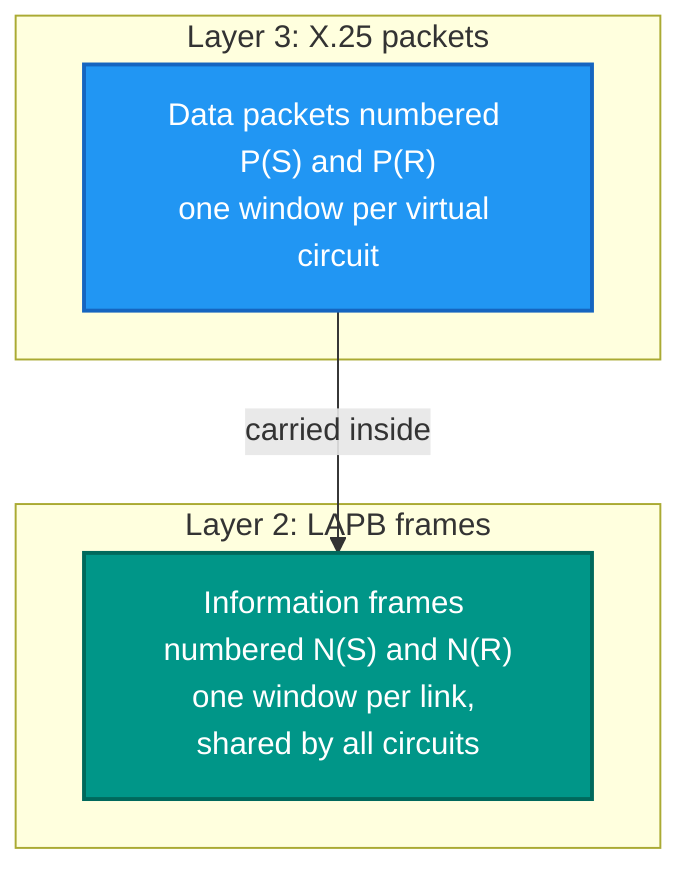

# Modulo 128: LAPB, X.25, and how Cisco uses them

**Short answer.** Modulo 128 does **not work, at either layer.** RetroX25 numbers its frames and packets with
**modulo 8** only (numbers 0 to 7, at most 7 outstanding). It cannot be configured: both layers refuse a modulo 128
setting, and the Desktop app shows "8" as fixed text and refuses a loaded configuration that asks for 128.

**Two independent settings.** Modulo 128 is chosen separately for each layer, and each layer's peer must agree with
it. Both can be 128, both 8, or they can differ. The window size is a third, separate setting at each layer.

| Setting | Where it is configured | Works today? |
|---|---|---|
| LAPB (link) modulo, 8 or 128 | `Lapb.Modulo` in the runtime configuration | **No.** Nothing in the engine reads it. LAPB window: 1 to 7. |
| X.25 packet modulo, 8 or 128 | `X25.ExtendedPacketSequencing` in the runtime configuration (the engine's own packet-layer setting is `X25Config.Modulo`) | **No.** Nothing in the engine reads the runtime setting, and the packet layer throws if its own `Modulo` is not 8. X.25 window: 1 to 7. |

This page was written on 2026-11-12 from reading the RetroIO source and the Cisco documents listed in section 4.
Nothing in the source was run for it.

## 1. How the two layers fit together

| | Modulo 8 (basic) | Modulo 128 (extended) |
|---|---|---|
| Sequence numbers | 0 to 7 | 0 to 127 |
| Largest window | 7 | 127 |
| LAPB control field of I and S frames | 1 byte | 2 bytes (U frames keep 1 byte) |
| LAPB link set-up command | SABM | SABME |
| X.25 packet header | 3 bytes, P(S) and P(R) inside the type byte | 4 bytes for data, P(S) and P(R) in their own bytes; header marker bits say "modulo 128" |

Why it exists: with a window of 7 and a slow answer, the sender stops and waits. A longer window keeps more
frames (LAPB) or packets (X.25) in flight on a link with a long delay or a high speed. Choosing 128 does not help
unless the window is also raised.

## 2. LAPB (layer 2)

### Where RetroX25 stands: not implemented

| Part | State | Where (RetroIO source) |
|---|---|---|
| Configuration value | `Modulo` exists on the runtime's LAPB settings but **nothing reads it** | `RetroIO.Protocols.X25.Runtime`, `RuntimeConfig.cs` |
| Link options | No modulo field; a window outside 1 to 7 is refused | `RetroIO.Lapb`, `LapbOptions.cs` |
| State machine | Sequence arithmetic is hard-coded `& 0x07` in about 20 places | `RetroIO.Lapb`, `LapbLayer.cs` |
| Control field | One byte only; sequence mask 0x07 | `RetroIO.Lapb`, `LapbControl.cs` |
| SABME | Exists as a name for display only; no code sends or answers it | `RetroIO.Link`, `LapbControlField.cs` |

In the Desktop app the LAPB modulo is fixed text ("8 (modulo 128 is not implemented)"), a loaded file that asks
for 128 is refused with a message, and the LAPB window is limited to 1 to 7.

### What it would take

1. A `Modulo` field in the link options, set from the runtime configuration (today it is ignored), and the
   window limit raised to 127 when the modulo is 128.
2. Sequence arithmetic in the state machine made modulo-aware: every `& 0x07` becomes a mask or remainder
   taken from the link's modulo (send state, receive state, acknowledge state, the window check, the
   check that N(R) is in range).
3. A two-byte control field for I frames and S frames (RR, RNR, REJ) in the frame reader and writer, with
   7-bit numbers and the poll/final bit in its own place. U frames stay one byte.
4. SABME: send it instead of SABM when the link is set to 128, accept it as the peer's request, answer with a
   UA, and refuse (DM) or fall back as the spec says when the two ends disagree.
5. The frame-reject (FRMR) information field, which is longer in modulo 128 mode.
6. The frame monitor and decoder views.
7. A changed modulo or window applied only when the link is reset (this is what Cisco does, section 4).
8. Unit tests for both ends: set-up with SABME, a window of 127 filling and draining, wrap-around at 128,
   rejection and recovery, mixed modulo between two ends, and the existing modulo 8 tests unchanged.

## 3. X.25 packet layer (layer 3)

### Where RetroX25 stands: not implemented

| Part | State |
|---|---|
| The running engine | **Refused.** Setting the modulo to 128 throws when the packet layer starts ("only modulo 8 sequence numbering is implemented"), and a modulo 128 packet is rejected with diagnostic 40 (invalid format). Windows above 7 are refused. |
| The runtime setting | `X25.ExtendedPacketSequencing` is saved in the configuration file and shown in the Desktop, but **nothing in the engine reads it**. |
| Packet builder and parser | Code exists that builds and reads modulo 128 packet formats (`X25PacketBuilder`, `X25PacketParser`). **It has no unit tests** apart from a single-bit check, and it has never been used by a running call. Whether it is correct is **not known**. |
| Showing packets | The packet decoder and the Desktop packet window print "Mod=128" for such a packet. |

The only modulo 128 unit tests that exist check that it is refused (`R18_Modulo128_IsRefusedUntilItExists`,
`R18_AModulo128DataPacket_IsDiagnostic40`). Nothing tests that modulo 128 works, because it does not.

In the Desktop app the old "extended packet sequencing" checkbox is replaced by fixed text ("8 (modulo 128 is not
implemented)"), a loaded file that asks for it is refused with a message, and the X.25 default window is limited to
1 to 7.

### What it would take

1. Allow modulo 128 in the packet layer configuration and in the window facility (windows up to 127), and connect
   the runtime setting to it.
2. Per-circuit modulo, negotiated at call set-up through the call's header marker bits, instead of one value
   for the whole layer.
3. Make the engine's window arithmetic (outstanding count, P(R) checks) modulo-aware, and stop dropping
   modulo 128 packets as invalid.
4. Unit-test the existing builder and parser for data, RR, RNR and REJ, fix what the tests find, and add the same
   for the other packet types that carry sequence numbers.
5. Tests as for LAPB, plus a call that mixes a modulo 8 and a modulo 128 end.

### Size

I have not measured this. My own guess is that the LAPB part is the larger one (the state machine and the
control field), and that the whole job is a matter of days with tests, in a library whose existing tests
guard the modulo 8 behaviour. Treat that as a guess, not an estimate you can plan from.

## 4. How Cisco uses them

Read on 2026-11-12. Two Cisco documents:

- **Command reference**, chapter "H": the `lapb modulo` and `lapb k` commands
  (https://www.cisco.com/c/en/us/td/docs/ios/wan/command/reference/wan_book/wan_h1.html).
- **Configuration guide**, "Configuring X.25 and LAPB"
  (https://www.cisco.com/en/US/docs/ios-xml/ios/wan_smxl/configuration/15-2s/wan-cfg-x25-lapb.html). The
  whole page was read through a summarising fetch tool.

### LAPB on Cisco

- `lapb modulo` takes **8 or 128**. 8 is the basic mode and the default, "widely available because it is required
  for all standard LAPB implementations". 128 is the extended mode, for more unacknowledged frames on high-speed,
  low-error links.
- "Both ends of a link must use the same LAPB mode."
- The window is set separately with `lapb k`: from 1 up to the modulo minus 1, so at most 7 with modulo 8 and 127
  with modulo 128. Default 7. "When using modulo 128 mode, you must increase the window parameter k." The value
  must match the peer's, or the link shows repeated REJ frames.
- A changed modulo or window takes effect only when the protocol is reset.

### X.25 packet layer on Cisco

- "The Cisco implementation of X.25 supports modulo 8 (default) and modulo 128 packet sequence numbering."
- "The X.25 modulo and the LAPB modulo are distinct and serve different purposes." The command reference says the
  same: "The X.25 modulo is independent of the LAPB layer modulo."
- DTE and DCE must use identical X.25 modulos. A change made while the interface is up takes effect only after
  X.25 restarts the packet service.
- Windows: the X.25 default input and output window is **2** (set by the network administrator), used for calls
  that do not negotiate a window and for PVCs unless configured otherwise. A window can go up to 7, or 127 with
  modulo 128 operation. The `x25 subscribe windowsize` command limits what a call may negotiate.
- X.25 over Frame Relay (Annex G) supports both modulo 8 and 128.

### XOT on Cisco and in the standard

Read on 2026-11-12 through a fetch tool that summarises pages, so the quotes below are its extracts, not checked
word for word. Check the exact wording at the source before you cite it.

- Cisco: XOT carries X.25 packets over a reliable TCP stream. "Flow control is maintained end-to-end." When a call
  leaves a flow control value unspecified, XOT supplies a window of **2** packets and a maximum packet size of
  **128** bytes.
- Cisco `x25 modulo` (command reference, https://www.cisco.com/en/US/docs/ios-xml/ios/wan/command/wan-x1.html):
  values 8 or 128, default 8, "must agree with that of the device on the other end of the X.25 link". Modulo 128 is
  "also referred to as extended packet sequencing numbering, which allows larger packet windows".
- Cisco window limits: `x25 win` and `x25 wout` range from 1 to one less than the modulus, default 2. A
  `windowsize` facility is 1 to 127 and must stay below the modulo.
- The Cisco pages do **not** say whether the X.25 modulo setting applies to XOT calls, and the configuration guide
  describes no LAPB under XOT. That stays unverified for Cisco.
- RFC 1613 (https://www.rfc-editor.org/rfc/rfc1613.txt): the XOT header is only a version and a length (4 bytes),
  so no LAPB frame travels in it; LAPB belongs to the router's other, local interfaces (section 3 of the RFC).
  Modulo 128 over XOT is an **optional** feature: an XOT that supports mixed-modulo connections must set the
  proper modulus bits in the packet General Format Identifier, and must refuse the call or lower the window when a
  modulo 128 call asks for a window of 8 or more towards a modulo 8 side (section 6.2). The RFC states no
  "LAPB is not used" sentence.
- Not found anywhere: a statement that a given Cisco release does XOT with modulo 128.

### What this means for RetroX25

- Cisco's two modulo settings and two window settings match the split in this document, so the design above
  (two separate settings, window separate from modulo, apply on reset) follows Cisco's.
- The Cisco bench in [cisco-gns3-xot-test.md](cisco-gns3-xot-test.md) runs over XOT with the Cisco default window of
  2 and modulo 8, which RetroX25 supports. LAPB is not involved, so the LAPB settings do not matter for that bench.
- Modulo 128 would matter for a **serial or TCP-LAPB link** to equipment set to 128 (a Cisco serial interface with
  `lapb modulo 128`, for example), or for a long-delay link where a window of 7 limits the speed.
