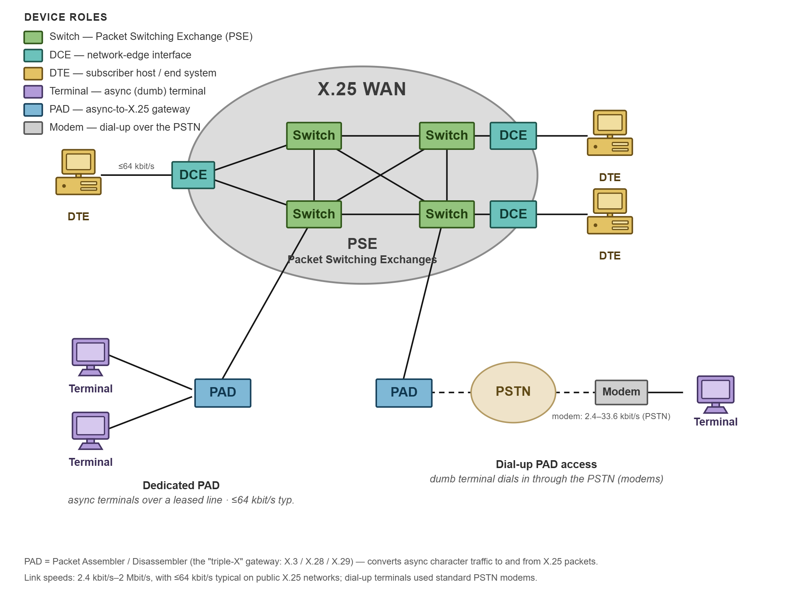
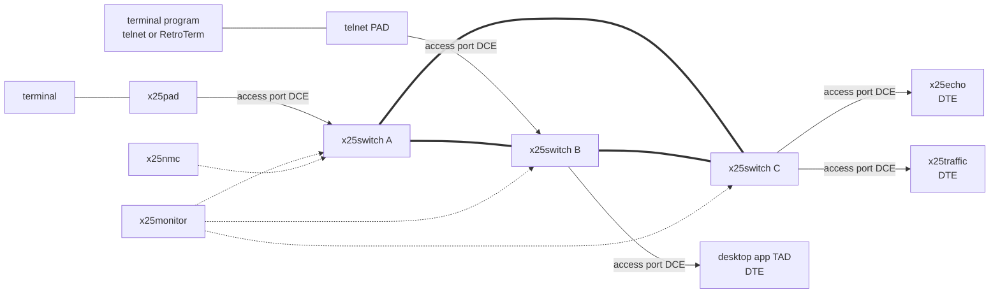

# A country X.25 network, and how these programs simulate it

The drawing is a public X.25 network of one country, the way the telephone companies ran them from the 1980s.
This page explains the parts of the drawing, how a call travels through it, and which program of this
repository plays each part. The programs themselves are listed in [tools.md](tools.md).

## The parts

| In the drawing | What it is in a real network | What it is in this repository |
|---|---|---|
| **Switch (PSE)**, the green boxes in the cloud | A Packet Switching Exchange: a computer that takes a call in on one line, looks at the address that is called, and sends it out on the line that leads towards that address. The switches are joined to each other by lines of their own (trunks) in a mesh, so there is more than one way across. | One `x25switch` program for each switch. Each has its own configuration file with its ports and its routes. |
| **DCE**, the blue-green box between a subscriber and a switch | The network's end of a subscriber line. The DCE side of the X.25 link rules is the network, the DTE side is the customer. | A port of the switch set to the DCE role (`type = access`, `mode = dce` in the switch file). |
| **DTE**, the yellow computers | A subscriber's own computer: a bank's host, a library, a company's mainframe. It speaks X.25 on the line and is reached by an address. | A program that connects to an access port and behaves as a DTE: `x25echo`, `x25traffic`, the built-in server (TAD) of the desktop application. A Cisco router or the `x25emu` programs can also act as DTEs. |
| **PAD**, the blue boxes below | A Packet Assembler/Disassembler. A simple terminal can only send and receive characters. The PAD collects the characters into X.25 packets, sends them to a host and prints what comes back. It is controlled by three standards: X.3 (the PAD's settings), X.28 (the commands you type at the PAD) and X.29 (how the host changes those settings). | `x25pad`, the PAD window of the desktop application, and the telnet PAD. |
| **Terminal**, the purple screens | A person at a keyboard and a screen with no X.25 of its own. | Your keyboard and console, or any terminal program (`telnet`, PuTTY, RetroTerm) connected to the telnet PAD. |
| **Dedicated PAD**, the left side below | The terminals reach the PAD over their own line (a leased line, up to 64 kbit/s as a rule). | A terminal on the same computer as `x25pad`, or a terminal program connected to the telnet PAD. |
| **Dial-up PAD**, the right side below | A terminal dials the PAD through the telephone network (PSTN) with a modem (2.4 to 33.6 kbit/s). | **Not simulated.** There is no modem or telephone network in the repository. The telnet PAD gives the same result for the person (a terminal reaches a PAD without owning an X.25 line) but over TCP. |
| **Lines in the cloud** (switch to switch) | Leased lines between the exchanges. The drawing's note gives 2.4 kbit/s to 2 Mbit/s, with 64 kbit/s or less typical on public networks. | A trunk port: `hdlc-tcp` (the same framing a leased line carries, over a TCP connection), `hdlc-serial` (a real serial port at a chosen speed) or `xot` (X.25 over TCP, RFC 1613, what a router speaks). See [trunk-links.md](trunk-links.md). |
| **Lines from the subscribers to the DCE** | A leased line, up to 64 kbit/s as a rule. | A TCP connection to an access port (XOT), or HDLC over TCP or serial. |

## How a call travels

Take a call from the DTE on the left to a DTE on the right. All numbers below are the ones a real network uses:

1. **Call Request.** The calling DTE sends one packet to its DCE: "I want address 2350 0001". The packet carries the
   called address, the calling address, a few settings (packet size, window size) and a small field of call
   user data.
2. **Routing.** The first switch looks at the called address. An address in X.121 form starts with the **DNIC**,
   four digits: three for the country and one for the network. If the DNIC is this network's, the rest of the
   number picks the subscriber; if not, the call goes towards another network. In the switch file the
   routes say this: a route by exact address, by address prefix, by DNIC, or a default route.
   The full rules: [X.121 addresses and X.25 routing](https://github.com/RetroCoreLabs/RetroIO/blob/main/src/RetroIO.Protocols.X25/X121-ADDRESSING.md).
3. **Switch by switch.** Each switch passes the call on towards the called address. Every link has its own
   **logical channel numbers**, so the same call has a different number on each link. The switch keeps the
   join between the two numbers for as long as the call lasts.
4. **Incoming Call.** The last switch's DCE hands the call to the called DTE as an Incoming Call.
5. **Call Accepted, Call Connected.** The called DTE accepts. The answer travels back, and the caller gets Call
   Connected. The call is now a **virtual circuit**: not a wire of its own, but a path through the switches that
   every packet of the call follows.
6. **Data.** Both sides send data packets (128 bytes is the usual size). Each side may have only a few packets
   unacknowledged at once (the **window**). A receiver that is slow holds the window shut, and that
   is how X.25 slows a sender down without losing data.
7. **Clear.** Either side sends Clear Request with a **cause** and a **diagnostic** that say why. The other side
   confirms, and the switches free the channels.

A **PAD** adds one thing to this. The terminal's characters are collected into data packets, and the PAD puts a
short marker (the four bytes `01 00 00 00`) in the call user data of its Call Request, which tells the called host
"this is a PAD". Cisco's PAD service refuses a call without that marker; that was measured on a router and has not
been checked against the text of X.29. After that, the host can
change the PAD's settings with special packets marked with the **Q bit**: that is X.29.

## The simulation, program by program

The demo in [demo/README.md](../demo/README.md) is the closest thing that exists and runs today: three
switches in a chain (A, B, C), the trunks between them as leased-line style HDLC, a PAD at one end and the echo
service at the other. It is tested. The drawing above has more than that: **four switches joined in a mesh**
(each connected to more than one other, so a call can take two ways), three subscribers and two PADs. The pieces
for it are all there (any number of switches, trunk ports of three kinds, routes of four kinds), but a
four-switch mesh configuration has **not** been built or tested yet, so this page does not claim it works.

The programs that watch the network are not in the drawing but are part of running one:

- `x25monitor` connects to the monitor port of each switch and shows a map, the live packets decoded, the state of
  each trunk and the logs.
- `x25nmc` reaches a switch by placing an X.25 call to the switch's management address, the way a real network
  management centre did.
- `x25trace` decodes the packets on one XOT connection.
- Each switch also has a telnet console (`show x25 route`, `show x25 vc`, `show x25 port`, `show x25 stats`).

## From one country to two

A single network is the drawing on this page. Two countries are two such networks joined by **X.75**, the
Recommendation for the link between two public packet networks. Each network has a gateway exchange at its border
(an **STE**), and X.75 runs between the two STEs. This repository does not do that yet. It is the next page.
